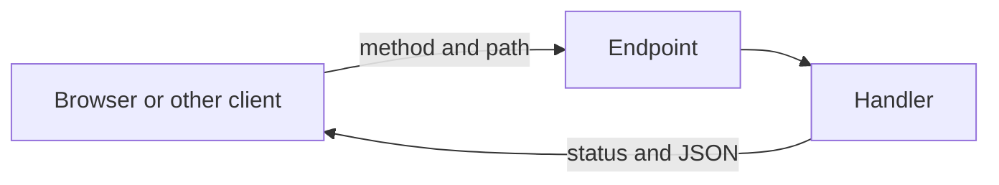

# API

An API is the list of requests your server agrees to answer. Each item on the
list is an endpoint: a method plus a path. The frontend, a later phone app, and
your own tests all use this list. If the list is vague, every client invents a
different ask.

## How it works

## The pages

1. [Methods](methods.md): `GET`, `POST`, `PUT`, `PATCH`, `DELETE`, and what each
   one promises
2. [Endpoints](endpoints.md): how to name a path and what comes back
3. [Handlers](handlers.md): the function that performs one endpoint
4. [Choosing a style](choosing-a-style.md): REST as the default, and when
   something else is worth it

The longer version with status codes is
[APIs and endpoints](../fullstack/07-apis-and-endpoints.md). This folder is the
vocabulary you use when you tell an AI what to build.

Paste the stack prompt from [prompts](../prompts/README.md). Each prompt names
the error shape and forbids writes on `GET`, so you do not have to re-explain
the API rules in every chat.
