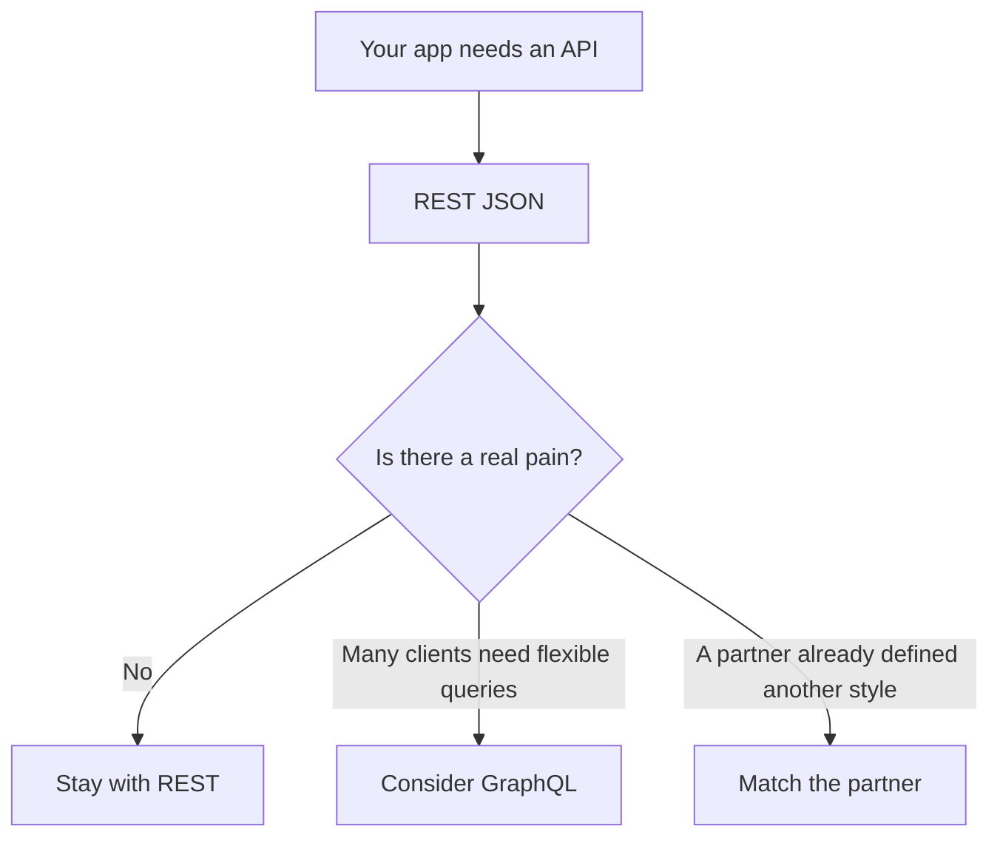

# Choosing an API style

REST is the default: a URL names a thing, the HTTP method names what you are
doing, and JSON is the body. Tell your AI "REST-style endpoints" and you will
get something you can read. Other styles exist. They are choices for a specific
pain, not upgrades.

## How it works

**REST.** Perk: every language and every AI tool knows it. Browser tools, logs,
and caches understand `GET`. You can open a URL and see a read. Cost: a screen
that needs five related things may make five requests, or you add one endpoint
that returns the bundle. Adding that endpoint is normal. It is not a reason to
change styles.

**GraphQL.** One URL, and the client asks for the fields it wants. Perk: a
complex app with many different screens can fetch exactly the shape it needs.
Cost: caching, authorization, and "this field is expensive" become your problem
on every field. AI tools also generate resolvers that forget the ownership
check. Do not start here.

**RPC.** A URL per action, such as `/archiveProject`, sometimes with no real
distinction between methods. Perk: the name can match a function you would say
out loud. Cost: you lose the "GET is safe" promise if you are careless. A few
action paths on top of REST (`POST /projects/42/archive`) give you the perk
without throwing out the verbs.

**tRPC and similar.** TypeScript types shared between the website and the
server, so the client calls a function instead of building a request. Perk:
renaming a field breaks the build on both sides. Cost: only TypeScript clients
get the benefit, and a phone app or a partner still needs a normal HTTP API.
Fine inside one TypeScript product. Do not make it the only door if a second
client is the reason you have an API.

## How to choose

| Situation | Style |
| --- | --- |
| Almost every app in this repo | REST JSON |
| One TypeScript app, and you hate hand-written fetch calls | REST, or tRPC inside that app only |
| A partner sent you a spec | Their style, at the edge, and translate inward |
| You have not shipped the main task yet | REST |

Write the choice in the decisions note: "REST, error shape `{ "error": "..." }`,
no GraphQL." That sentence is doing the work.

## Common mistakes

- **GraphQL on day one** because a tutorial used it. You now have two things to
  secure.
- **A different style in each folder.** One style per app.
- **Versioning the URL before you have a second client.** Adding fields is
  enough until something external depends on the old shape.

## What to tell your AI

"REST JSON only. Plural paths, HTTP methods, one error shape. No GraphQL and no
second API style. Action endpoints are POST on the resource, not a new style."

## Further reading

- [Methods](methods.md)
- [Endpoints](endpoints.md)
- [APIs and endpoints](../fullstack/07-apis-and-endpoints.md)
