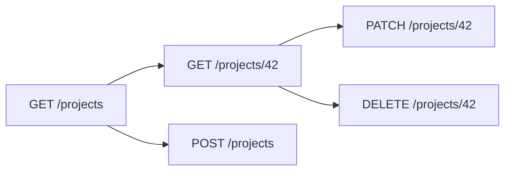

# Endpoints

An endpoint is one URL that does one job. The path names the thing. The method
names the verb. Together they are the sentence: `PATCH /projects/42` means
"change project 42". A client should be able to guess the next endpoint from the
ones it has seen.

## How it works

Name the collection in the plural, then the id:

- `GET /projects` lists the signed-in user's projects
- `POST /projects` creates one
- `GET /projects/42` reads one, if this user may see it
- `PATCH /projects/42` updates it
- `DELETE /projects/42` deletes it

Nest a path when the relationship is real: `/projects/42/tasks`. Do not nest for
decoration.

**The server decides whose rows come back.** A caller who sends
`userId=someone-else` does not get those rows. The session already says who they
are.

**JSON is the body.** It is text with labeled values, such as
`{ "title": "Launch" }`. Send `Content-Type: application/json`. Return the same
shape for errors on every endpoint: `{ "error": "Title is required" }`.

**Status codes** are part of the endpoint, not an extra. `201` when a create
works. `401` when nobody is signed in. `403` when they are signed in and still
not allowed. `404` when there is nothing they are allowed to know about. Use
`404` rather than `403` when a `403` would reveal that a private row exists.

You do not need `/api/v1` on day one. You need to stop renaming fields after a
client depends on them. Adding a field is safe. Removing one is not. Write the
current list in your MCP notes.

## Common mistakes

- **`/getProjects` and `/project`.** Plurals, nouns, verbs only for actions
  (`/archive`).
- **One endpoint that accepts an `action` field and does everything.** You cannot
  secure or log that cleanly.
- **A different error shape on each route.** The screen cannot show it reliably.

## What to tell your AI

"Plural REST paths. JSON in and out. One error shape: { \"error\": \"sentence\" }.
Lists return only the signed-in user's rows. Do not put the user id in the body
as the source of identity."

## Further reading

- [MDN: Headers](https://developer.mozilla.org/en-US/docs/Web/HTTP/Reference/Headers)
- [Methods](methods.md)
- [Handlers](handlers.md)
