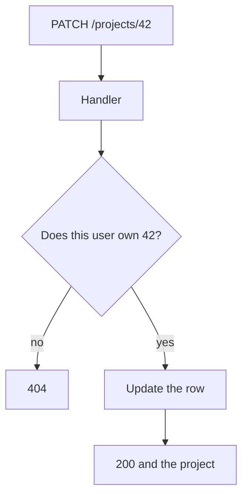

# API handlers

An API handler is the function behind one endpoint. Middleware has already run.
The handler reads the path and the body, does one job, and returns a status and
a body. In Express it is the function you pass to `app.post`. In Next.js it is a
route handler. In Go it is an `http.Handler`. The contract is the same in every
language.

## How it works

A handler has four beats:

1. **Identity** comes from the session the middleware loaded, not from the body.
2. **Input** is checked. Missing title, wrong type, empty string: `400` and the
   error sentence.
3. **The query** includes the owner's id. Loading by id alone is the bug where
   someone edits the URL.
4. **The response** uses the status code that matches the outcome, and the JSON
   shape you promised.

Keep one job in the function. "Update the title" is one job. "Update the title,
email the team, and rebuild search" is three. The extra work can be a named
function the handler calls. It should not be an unnamed block that the next chat
is afraid to touch.

## Common mistakes

- **A handler that returns the database error text.** That text can include table
  names and values. Log it on the server. Return the sentence you wrote.
- **Sharing one handler across methods** with a pile of `if`s. One function per
  method per path, unless the framework's own pattern says otherwise and you
  understand that pattern.
- **Doing the work on import.** The file loading is not a request. The handler
  runs when the request arrives.

## What to tell your AI

"One handler per endpoint. Session for identity, validation before write, owner
id in the query, status codes from the API page. No raw database errors in the
response."

## Further reading

- [Backend handlers](../backend/handlers.md)
- [Endpoints](endpoints.md)
- [Security](../fullstack/10-security.md)
