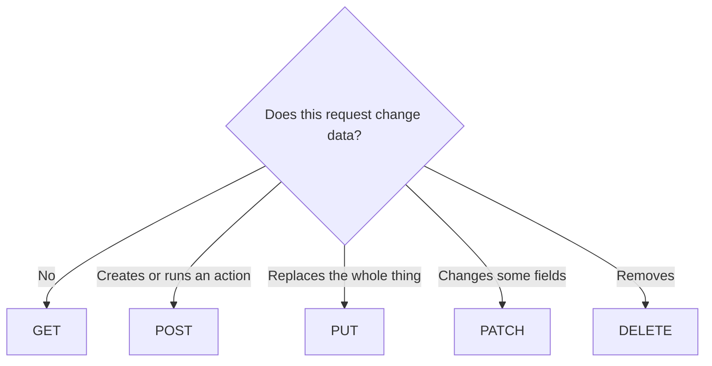

# Methods

An HTTP method is the verb on a request. It tells caches, browsers, and your
future self whether this ask is allowed to change data. Pick the verb from the
job. Do not invent a new one.

## How it works

| Method | What it promises | Example |
| --- | --- | --- |
| `GET` | Read only. Safe to retry. Browsers will retry it. | `GET /projects` |
| `POST` | Create something, or run an action. | `POST /projects` |
| `PUT` | Replace the whole record. | `PUT /projects/42` |
| `PATCH` | Change the fields you send. | `PATCH /projects/42` |
| `DELETE` | Remove. | `DELETE /projects/42` |

`GET` must not charge a card, delete a row, or send email. Link previews and
retries will call it.

`POST /projects/42/archive` is fine. You do not need a perfect noun for every
action. You need a verb that will not be repeated by accident.

**Retrying a write.** A shaky network sends the same `POST` twice. Creating two
projects is bad. For payments and similar actions, a second identical request
should return the first result. That property is called idempotency. A settings
form can skip it. Money cannot.

The full list of methods is the
[MDN reference](https://developer.mozilla.org/en-US/docs/Web/HTTP/Reference/Methods).

A "method" in JavaScript is just a function on an object. When you are talking
to an AI about the API, say "HTTP method" the first time.

## Common mistakes

- **`GET` that saves.** It will happen twice.
- **`POST` for every read.** Reads should be cacheable and harmless.
- **`200` with a body that says the action failed.** Failure uses `400`, `401`,
  `403`, `404`, or `409`. The list is in
  [the full-stack API page](../fullstack/07-apis-and-endpoints.md).

## What to tell your AI

"Use GET for reads, POST for create and actions, PATCH for partial updates,
DELETE for remove. No writes on GET. Return real status codes, not 200 with an
error flag."

## Further reading

- [MDN: HTTP methods](https://developer.mozilla.org/en-US/docs/Web/HTTP/Reference/Methods)
- [MDN: Status codes](https://developer.mozilla.org/en-US/docs/Web/HTTP/Reference/Status)
- [Endpoints](endpoints.md)
