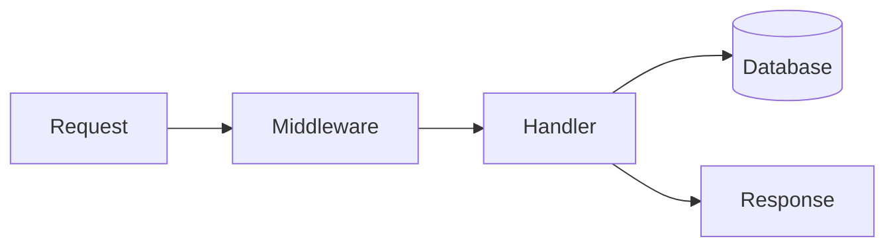

# Backend

The backend is the code that runs on a server you control. It receives a request,
decides whether this person may do this thing, reads or writes the database, and
sends a response. Visitors download the frontend. They do not download this.

JavaScript can be a backend language, and so can TypeScript, Python, Ruby, PHP,
Go, and Rust. The language changes the framework. It does not change the job.

## How it works

## The pages

1. [Handlers and middleware](handlers.md): the function for one request, and the
   checks that run before it
2. [Languages](languages.md): JavaScript, TypeScript, Python, Ruby, PHP, Go, and
   Rust, and what each one is good at
3. [Choosing a language](choosing-a-language.md): pick from the goal, not from a
   benchmark

Frameworks that wrap a backend (Express, Next.js, Django, Rails, and the rest)
are compared in [backends](../fullstack/06-backends-and-express.md) and
[full-stack frameworks](../fullstack/05-fullstack-frameworks.md).

The words a request uses (`GET`, `POST`, status codes) are in the
[API folder](../api/README.md). Saved data is in the
[database folder](../database/README.md).

Paste a combination, with the reason, from [prompts](../prompts/README.md).
