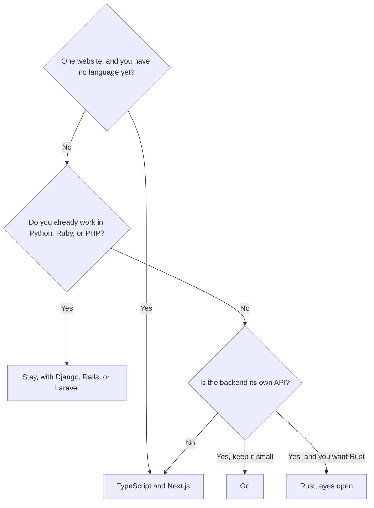

# Choosing a backend language

Choose the language after you can say what the app is. A language is a good
choice when it has a framework for that shape of app and your AI tool can be
pinned to that framework's current docs. It is a bad choice when you picked it
because it won a chart.

## How it works



**No preference, one website people log into.** TypeScript. Next.js puts the
screens and the server in one project, which is the shape with the fewest
invented pieces. This is the default in
[choose your stack](../fullstack/13-choose-your-stack.md).

**You already write Python, Ruby, or PHP.** Stay. Django, Rails, or Laravel will
get you to a working app faster than changing languages so you can use the
JavaScript default. Point the MCP server at that framework's docs.

**The screens should look like HTML.** Still TypeScript if you use Vue (Nuxt) or
Svelte (SvelteKit). Use Python, Ruby, or PHP if you use HTMX and want the server
to return HTML.

**A second client needs the same rules.** The language of the API can be
TypeScript (Express, Fastify, Hono, NestJS) or Go. TypeScript wins when you want
the most examples. Go wins when you want a small language and one deployable
file. NestJS wins when the API is large and several people need a fixed
structure.

**You want Rust.** Use it for the API, with Axum, and keep TypeScript on the
screens. Put the Rust book and the Axum docs in the MCP server. Expect to read
compiler errors. If that is not the project you want, choose Go or TypeScript
and do not apologize.

**A content site.** The language barely matters. Astro and TypeScript are the
default. Do not introduce Rust to render a blog.

## What you say out loud

Fill this in and keep it in the decisions note:

```text
Backend language: <TypeScript | Python | Ruby | PHP | Go | Rust>
Why: <one sentence from this page>
Framework: <the one that matches>
Not using: <the languages you considered>
```

The "why" sentence is what stops the next chat from rewriting the server in a
different language because a snippet was shorter.

## Common mistakes

- **Two backend languages.** A Next.js app that also starts a Go server "for
  later" is two apps.
- **Changing language after the models exist.** That is a rewrite. Decide on
  this page first.
- **Letting the AI pick Rust to look serious.** Serious is a backed-up Postgres
  and an ownership check. The language does not add those.

## What to tell your AI

"The backend language is `<language>` because `<why>`. The framework is
`<framework>`. Do not introduce another language. If you think the language
cannot do the task, stop and tell me. Do not switch quietly."

## Further reading

- [Languages](languages.md)
- [Prompts for each combination](../prompts/README.md)
- [Choose your stack](../fullstack/13-choose-your-stack.md)
