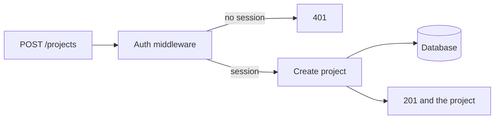

# Handlers and middleware

A backend handler is the function that runs for one request. The request names a
method and a path, such as `POST /projects`. The handler checks the input, does
the work, and sends a status code and a body. Middleware is a function that runs
before the handler, on many routes: "who is signed in?", "is this JSON?", "has
this address called us too often?".

A frontend handler runs because of a click. This one runs because a request
arrived. If you only remember one, remember that the backend handler is the one
that can say no.

## How it works

**The handler trusts the middleware for identity, then checks the row.** The
middleware loads the user from the session. The handler still asks "is this
user's project?" when the route names an id. A signed-in person is not allowed
to edit every row.

**Input is checked here, again.** The form already checked it. The handler
checks it because other clients will not. Bad input gets `400` and one error
sentence. It does not get written.

**The handler is short** because the query and the check have names. A handler
that also sends email, resizes images, and recalculates billing is three jobs.
The request can start those. It should not do all of them inline if they are
slow. For a first version, a short save is fine.

Express calls these functions middleware and handlers. Next.js calls the handler
a route handler. Django calls it a view. Rails calls it a controller action. Go
uses a function with the `net/http` handler shape. Same role.

## Common mistakes

- **Taking the user id from the JSON body.** The session is the identity. The
  body can claim anything.
- **Copying the auth check into every handler, then forgetting one.** Put it in
  middleware and attach that middleware to the private routes.
- **A handler that returns 200 when the save failed.** Use the status codes in
  [API methods](../api/methods.md).

## What to tell your AI

"Every private route runs auth middleware first. The handler loads the user from
the session, validates input, and scopes the query to that user. No database
access from a browser file. Keep the handler to one job."

## Further reading

- [Backends, including Express](../fullstack/06-backends-and-express.md)
- [API endpoints](../api/endpoints.md)
- [Frontend handlers](../frontend/handlers.md), which are a different layer
