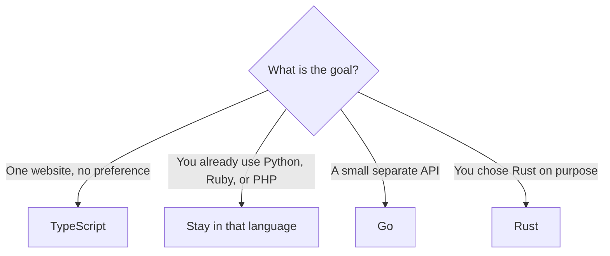

# Backend languages

A backend language is the one your server runs. The browser still receives HTML,
CSS, and JavaScript. Pick the language for the server you want to operate and for
the framework that matches it. Speed charts are a weak reason. A language your AI
tool invents APIs for is an expensive reason.

## How it works

## JavaScript and TypeScript

**JavaScript** on the server runs on Node.js. Perk: it is the same language as
the browser, and it has the most web-app examples an AI has seen. Cost: the
language will not stop you from mixing server code into a browser file.

**TypeScript** adds types on top of JavaScript. Perk: the shape of a request and
the shape of a row are named, so a made-up field fails the build. Cost: you wait
on a compiler, and you have to read what it says. For a product an AI will keep
editing, TypeScript is the default. Docs:
[typescriptlang.org](https://www.typescriptlang.org/docs/).

Frameworks: Next.js, Nuxt, SvelteKit, Express, Fastify, Hono, NestJS, Angular.

## Python

Python reads close to English, which is a real advantage when you are reviewing
code you did not type. Perk: [Django](https://docs.djangoproject.com/en/stable/intro/overview/)
includes an admin, a database layer, and strong opinions, and Python is the
language most data tools speak. Cost: it is not the browser language, so a rich
client is a second project. Pin Django's current docs. Old Python web tutorials
skip the checks this repo insists on.

Docs: [Python tutorial](https://docs.python.org/3/tutorial/).

## Ruby

Ruby is built for a particular kind of clarity, and
[Rails](https://guides.rubyonrails.org/getting_started.html) uses that to make
folder names decide behavior. Perk: a database-backed app appears quickly if you
follow the conventions. Cost: fighting the conventions, or letting an AI ignore
them, creates a mess faster than in a loose JavaScript project. Docs:
[ruby-lang.org](https://www.ruby-lang.org/en/documentation/).

## PHP

PHP runs a large share of existing websites, and
[Laravel](https://laravel.com/docs) is the batteries-included framework. Perk:
hosting is widespread, and Laravel covers queues, mail, and auth in one style.
Cost: the internet is full of old PHP that concatenates SQL. Hold the tool to
Laravel's current docs, not to a ten-year-old snippet. Docs:
[php.net](https://www.php.net/manual/en/introduction.php).

## Go

Go is a small language aimed at servers. You compile it and get one file. You
copy that file to a machine and run it. The language has few features on purpose,
so a second person, or a second chat, has fewer places to hide a clever trick.
It is garbage-collected: you do not free memory by hand.

**Perks.** A single binary is simple to deploy. Startup is fast. The standard
library serves HTTP ([`net/http`](https://pkg.go.dev/net/http)), so a small API
does not need a framework. Concurrency (doing more than one thing at a time) is
part of the language and is understandable. AI tools know Go better than they
know Rust.

**Costs.** You write more of the plumbing than you would in Rails or Django.
There is no single full-stack "Go Next.js" that also gives you a rich UI. The
UI is still a frontend, or HTML rendered by the Go server.

**Pick Go when** the backend is its own API and you want it obvious and easy to
ship. A logged-in product with a rich UI can still use Go for the API and
TypeScript for the screens. Do not pick Go because a post said it is faster than
Node. Your first limit will be the database, not the language.

The [Go docs](https://go.dev/doc/) and the
[writing web applications article](https://go.dev/doc/articles/wiki/) are the
references to put in your MCP server.

## Rust

Rust is a systems language. The compiler checks memory safety before the program
runs, and there is no garbage collector. People use it where a leak, a crash, or
a slow service is expensive: infrastructure, parsers, performance-sensitive
APIs.

**Perks.** Whole classes of memory bugs are refused at compile time. A Rust API
can be very fast and very explicit about errors. [Axum](https://docs.rs/axum/latest/axum/)
is the web library to ask for if you are building an HTTP API. The language
itself is documented at [rust-lang.org/learn](https://rust-lang.org/learn).

**Costs.** The compiler rejects a lot of first drafts. That is the feature, and
it is also why vibe coding a first product in Rust is slow. AI tools invent
Rust that looks plausible and does not compile. You will spend the session
reading errors. There is no Rails-like "here is your whole app" path that is
safe to hand to a model and walk away from.

**Pick Rust when** you want Rust: you are ready to read compiler errors, or you
have a measured reason a simpler language cannot do the job. A weekend login app
is a poor place to meet the compiler for the first time. Go gives you the
separate-API shape with less friction. TypeScript gives you the most help from
the AI. Rust is the right answer for a smaller set of goals, and those goals are
real.

## How the perks line up

| Language | Strong at | Weak at, for this audience |
| --- | --- | --- |
| TypeScript | One language for UI and server, most AI examples | Will not stop a secret from shipping to the browser unless you separate files |
| Python | Readable apps, Django, data work nearby | Rich UI is a second project |
| Ruby | Rails conventions, shipping a full app | Thin AI examples if you leave the Rails path |
| PHP | Laravel, ordinary hosting | Old unsafe snippets all over the web |
| Go | Small APIs, one binary, few language tricks | More plumbing, UI is separate |
| Rust | Correct, fast services when you will face the compiler | First products, and any workflow that trusts generated code blindly |

## Common mistakes

- **A new language for each service.** One backend language.
- **Rust or Go for the buttons.** Those languages stay on the server.
- **Choosing from a benchmark.** Choose from the goal table in
  [choosing a language](choosing-a-language.md).

## Further reading

- [TypeScript](https://www.typescriptlang.org/docs/)
- [Python tutorial](https://docs.python.org/3/tutorial/)
- [Ruby documentation](https://www.ruby-lang.org/en/documentation/)
- [PHP introduction](https://www.php.net/manual/en/introduction.php)
- [Go docs](https://go.dev/doc/) and [`net/http`](https://pkg.go.dev/net/http)
- [Rust](https://rust-lang.org/learn) and [Axum](https://docs.rs/axum/latest/axum/)
