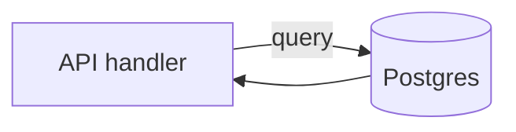

# Database

The database is where the product's facts live after the page refreshes: users,
projects, orders. Your server connects to it. The browser never does. The
language of the server does not pick the database. Postgres does, for almost
every app in this guide.

## How it works

## The pages

1. [Tables](tables.md): rows, columns, and how things point at each other
2. [Queries](queries.md): how you ask for rows without trusting the user's text
3. [Connections](connections.md): the URL, migrations, and backups
4. [Choosing a database](choosing-a-database.md): Postgres, SQLite, and MongoDB

The shipping details (hosts, pools, money as cents) are in
[Databases](../fullstack/08-databases.md). This folder is what you need when you
tell an AI what to store and what not to invent.

Every [prompt](../prompts/README.md) in this repo says Postgres unless the
scenario is explicitly a local prototype. That is deliberate.
