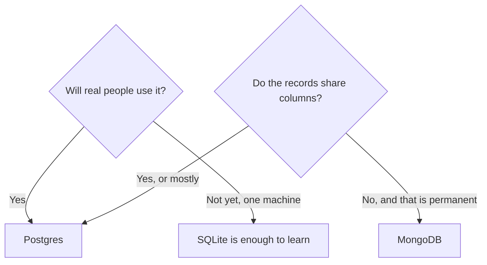

# Choosing a database

Postgres is the database for a web app you intend to put online. The other
options are real. They win in narrower cases. The programming language does not
pick this. Go, Rust, Python, and TypeScript all talk to Postgres well.

## How it works

**Postgres** stores tables and links between them, and it can store JSON when
one field is flexible. Perk: accounts, orders, and permissions fit this model,
and every framework in the prompt folder knows it. Hosted options include
[Neon](https://www.neon.tech/docs/introduction) and
[Supabase](https://supabase.com/docs). Pick it for any app with sign-in.

**SQLite** is one file on disk and speaks SQL. Perk: nothing to run, good for a
prototype or a single small server. Cost: many servers cannot share one file
cleanly. When you deploy a second copy of the app, move to Postgres. Docs:
[SQLite quickstart](https://www.sqlite.org/quickstart.html).

**MongoDB** stores documents that do not have to share one shape. Perk: you can
save a record before you know all the fields. Cost: "before you know" becomes
"we never decided", and links between records (this user owns these projects)
are the part you end up rebuilding. Reach for a JSON column in Postgres first.
Docs: [MongoDB introduction](https://www.mongodb.com/docs/manual/introduction/).

You do not need a second database for search, cache, or files on day one. Files
go in object storage. Search can be a later Postgres feature or a later service,
when the table is actually slow.

## What to tell your AI

"Postgres only. No MongoDB and no second database. SQLite only if I said this
prototype stays on one machine. Connection string from DATABASE_URL. Migrations
in git."

## Further reading

- [Postgres tutorial](https://www.postgresql.org/docs/current/tutorial-start.html)
- [Tables](tables.md)
- [Queries](queries.md)
- [Prompts](../prompts/README.md)
