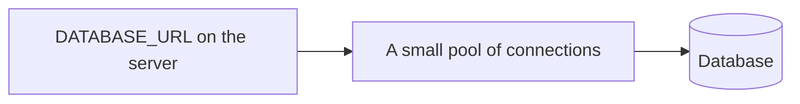

# Connections

The server connects to the database with a URL. That URL includes the address and
the password. It is an environment variable, usually `DATABASE_URL`. It is not in
git, not in the frontend, and not in a chat. The template for the name, with an
empty value, is [env-example](../fullstack/templates/env-example.md).

## How it works

A **pool** is a handful of open connections the server reuses. Opening a new one
on every click is slow. The library does this. You notice the word when the host
says the pool is full and requests are waiting.

A **migration** is a file that changes the tables: add a column, add an index.
Migrations go in git and run on each environment. Clicking around in the
production dashboard does not update the next environment, and the next deploy
will assume the column exists.

Use a different database for local, preview, and production. The same code,
different URLs. A preview that points at production will delete real rows.

Turn on backups the day you create the production database. Restore once to a
throwaway database so you know the button works.

The app's database user can touch this app's tables. It is not a superuser that
can drop every database on the machine. The database accepts connections from
the app, not from the whole internet.

## Common mistakes

- **One shared database for every environment.** You will wipe a customer while
  testing.
- **Editing production tables by hand.** Write a migration.
- **Committing a real URL** because `.env.example` looked like it wanted an
  example password. Empty means empty.

## What to tell your AI

"Read DATABASE_URL from the environment. Add the name to .env.example with an
empty value. Migrations for every schema change. Never print the URL. Preview
uses a different database from production."

## Further reading

- [Postgres tutorial](https://www.postgresql.org/docs/current/tutorial-start.html)
- [Neon](https://www.neon.tech/docs/introduction)
- [Supabase](https://supabase.com/docs)
- [Databases](../fullstack/08-databases.md)
