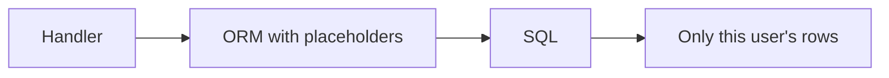

# Queries

A query is one question to the database: give me this user's projects, or insert
this row. SQL is the language those questions are written in. You will mostly
see them through an ORM such as Prisma, Drizzle, or the one built into Django,
Rails, or Laravel. The ORM is not a different database. It is a way to write the
question in your programming language.

## How it works

**Always scope private reads and writes.** "Projects where `user_id` is the
signed-in user" is the query. "Project where `id` is 42" is how one customer
opens another's project.

**Never glue the user's text into the SQL string.** That is injection: the
database runs what they typed, not only what you meant to ask. Placeholders,
which every serious ORM uses unless you bypass them, keep the text as a value.
The [OWASP cheat sheet](https://cheatsheetseries.owasp.org/cheatsheets/SQL_Injection_Prevention_Cheat_Sheet.html)
is the pattern to insist on.

**Ask for the related rows in the same query** when a page needs them. Loading
50 projects and then asking for each owner separately is 51 trips. It works in
development and gets slow with real data.

**Increments are one statement.** "Read the count, add one, write it back" loses
updates when two requests overlap. The database can add one itself. Use that for
stock, seats, and balances.

## Common mistakes

- **Raw SQL as a string with a variable in the middle**, even "just this once".
- **Filtering in JavaScript after fetching every row.** The filter belongs in
  the query, or you have copied the whole table into the server.
- **A query in a browser component.** The connection does not live there.

## What to tell your AI

"Use the ORM. Placeholders only. Every private query includes the signed-in
user's id from the session. Load related rows in one query. Do not filter a full
table in application code."

## Further reading

- [MDN: SQL](https://developer.mozilla.org/en-US/docs/Glossary/SQL)
- [OWASP: SQL injection prevention](https://cheatsheetseries.owasp.org/cheatsheets/SQL_Injection_Prevention_Cheat_Sheet.html)
- [Prisma](https://www.prisma.io/docs)
- [Drizzle](https://orm.drizzle.team/docs/overview)
- [Connections](connections.md)
