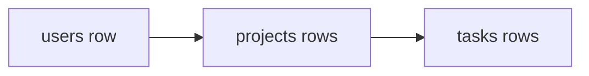

# Tables

A relational database stores tables. A table is one kind of thing: `users`,
`projects`. A row is one of those things. A column is one fact about it, such as
`title` or `created_at`. This shape is the product. If you cannot name the
tables, you do not know what you are building yet.

## How it works

A user has many projects. A project has many tasks. The project row stores
`user_id`. The task row stores `project_id`. Those columns are how you ask "this
person's projects" without searching the whole table by eye. Index `user_id` and
`project_id`, because those are the columns you will filter on constantly.

**Name tables after words a person would use.** `projects`, not `data`. Plural
table names, one id column, timestamps in UTC.

**Decide what delete means.** A `deleted_at` time lets you undo and lets an old
invoice still point at a customer. A real delete is gone. Say which one you
mean in the prompt.

**Files do not go in a table.** Store the file in object storage and save the
address in a column. Secrets do not go in a table either, except a password
hash, which is not the password.

**Money is integers of the smallest unit** (cents), not decimal numbers that
drift. A balance that is "almost 10" is a bug.

JSON inside a Postgres column is fine for one flexible field. A whole product
stuffed into one JSON column is a table you refused to design.

## Common mistakes

- **A table called `items` for three different ideas.** Split them when the
  columns start being optional depending on a type flag.
- **No owner column.** You cannot scope a query to the signed-in user if the row
  does not know its owner.
- **Inventing a second database** for "the flexible stuff". Postgres can hold a
  JSON column. A second database is a second backup and a second secret.

## What to tell your AI

"Postgres tables for the nouns in the product. Every private table has an owner
column. Foreign keys are indexed. Soft-delete with deleted_at unless I said
otherwise. No files and no plaintext passwords in the database."

## Further reading

- [Postgres: creating tables](https://www.postgresql.org/docs/current/ddl.html)
- [Queries](queries.md)
- [Choosing a database](choosing-a-database.md)
