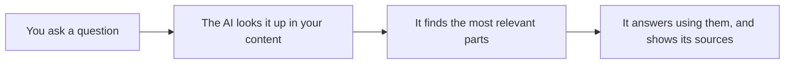

# What RAG is, in one page

**RAG lets an AI look things up before it answers.**

That is the whole idea. The letters stand for *retrieval augmented generation*:
retrieve (look up) some information, then use it to generate (write) the answer.

## An everyday comparison

Imagine asking a smart friend about your company's refund policy.

- **Without RAG**, they guess from what they know about refund policies in general.
  They sound confident. They might be wrong.
- **With RAG**, they open your actual policy document, find the right paragraph, and
  answer from it. They can even show you where they read it.

## Why not just paste everything into the chat?

You can, for one short document. But:

- AI models can only read so much at once (this limit is called the *context window*).
- Pasting a big manual every time is slow and costs more.
- You have to remember to do it, every time, in every tool.

RAG does the looking up for you, and only hands the AI the few paragraphs that matter.

## What you need for RAG

1. **Your content**: a website, documents, a GitHub repository, PDFs.
2. **A searchable copy of it**, called an *index*. Your content gets split into small
   pieces so the right piece can be found quickly.
3. **A way for your AI to search it**. Today the most common way is an *MCP server*,
   which is like a plug that lets AI tools use outside information.

You do not have to build any of these yourself. The
[starter architecture](03-starter-architecture.md) shows a no-code setup.

## Next

[Why your AI keeps forgetting, and how to fix it](02-why-context-matters.md)
