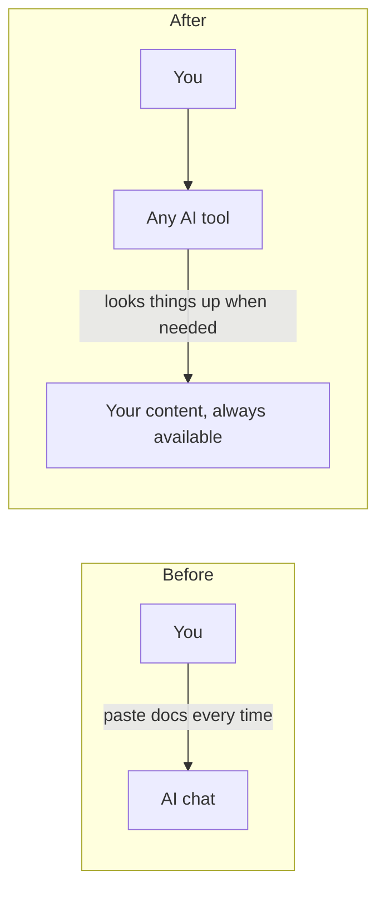

# Why your AI keeps forgetting, and how to fix it

If you build with AI, you have seen this: you explain your project, the AI does great
work, and the next day it has no idea what you are talking about. Or it confidently
uses a feature of a tool that does not exist.

That is not the AI being bad. It is the AI missing **context**: the information it
needs about *your* situation to give a good answer.

## Three kinds of forgetting

| What happens | Why | The fix |
|---|---|---|
| It forgets your project between chats | Each new chat starts empty | Give it a source it can look things up in every time |
| It invents features of tools you use | It is guessing from old training data | Let it read the tool's current docs |
| It ignores your own rules and decisions | They live in your head or scattered files | Write them down once, where it can find them |

## Persistent context

*Persistent context* means your AI can reach the same information every time, in every
tool, without you pasting it in. You set it up once.

## Why this matters for you specifically

When you are not a full-time developer, the AI is doing a lot of the work. Every
wrong guess it makes costs you hours you do not know how to get back. Good context is
the cheapest way to make your AI tools much more reliable, and it does not require
writing code.

## Next

[The starter architecture](03-starter-architecture.md)
