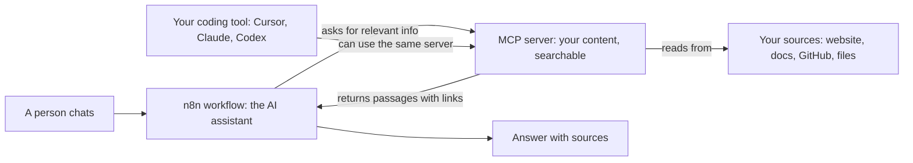

# The starter architecture

"Architecture" just means how the pieces of your app connect. Here is a simple one
that gives an AI assistant a lasting memory of your content, with no code.

## The picture

## The three pieces

### 1. Your sources

Whatever your assistant should know: your website, help docs, a GitHub repository,
product PDFs. You do not change them; they get read and indexed.

### 2. An MCP server (the memory)

This holds a searchable copy of your sources and lets AI tools search it. It is the
*persistent context*: set it up once, and every tool connected to it can use it.

Ways to get one without code:

- A hosted service that builds the server from your links and files. The tutorial
  uses [MCP Studio](https://appatools.com/mcp-studio?utm_source=github&utm_medium=oss&utm_campaign=ship-with-ai&utm_content=starter-architecture)
  (disclosure: I build it), which has a free tier.
- Many docs platforms now publish their own MCP server for their docs.
- Developers can run open source MCP servers themselves.

### 3. n8n (the assistant)

[n8n](https://n8n.io/) is a visual tool for building automations by connecting boxes.
Its AI Agent box can use an MCP server as a tool, so your assistant searches your
content before answering.

## Why this setup is a good start

- **No code.** Every step is clicking and pasting.
- **One memory, many tools.** The same MCP server works in n8n, Cursor, Claude, and
  other AI tools.
- **Easy to grow.** Add a source and every connected tool knows about it.

## Next

[Build your first AI assistant with n8n](04-build-your-first-assistant.md)
