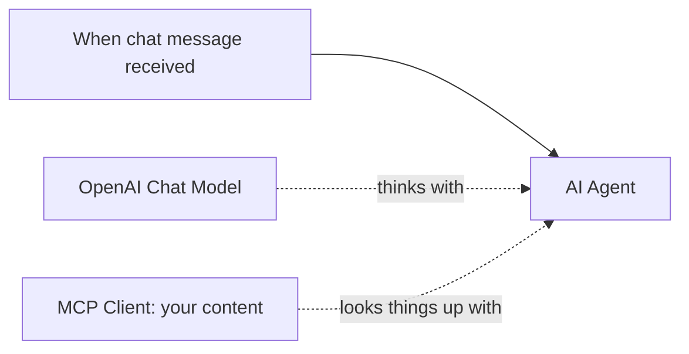

# Build your first AI assistant with n8n

You will build a chat assistant that answers questions from your own content and
shows where each answer came from. It follows the
[starter architecture](03-starter-architecture.md). Expect about 30 minutes, most of
it waiting for your content to be indexed.

## What you need

- An [n8n](https://n8n.io/) account (n8n Cloud or self-hosted both work).
- An [OpenAI API key](https://platform.openai.com/api-keys), or a key for another chat
  model that n8n supports.
- A link to content you want the assistant to know: your docs, help center, website,
  or a public GitHub repository.
- An MCP server for that content that supports streamable HTTP. Any one works with
  the same workflow. [Choose a context server](https://github.com/zthewriter/harness-engineering-cookbook/blob/v1.0.0/recipes/choose-a-context-server.md) lists hosted and open source
  options and how to check them.

## Step 1: create your MCP server (your assistant's memory)

1. Add the link to your content as a source on your MCP server. A specific section of
   a large site, such as `https://example.com/docs/`, gives better answers than a
   whole website.
2. Keep the server's default search tools, and deploy or start it.
3. Copy the server's streamable HTTP URL, such as
   `https://mcp.example.com/your-server-name`.

Indexing can take a few minutes. You can continue while it runs.

Doing this in MCP Studio

MCP Studio is one option. Disclosure: maintained by the author of this repo. The free tier includes 3 servers,
2 sources per server, and 50 requests a month, which is enough to finish this guide.

1. Sign in to
   [MCP Studio](https://appatools.com/mcp-studio?utm_source=github&utm_medium=oss&utm_campaign=ship-with-ai&utm_content=tutorial)
   and open the wizard.
2. Paste the link to your content as a source.
3. Keep the default tools, and continue through the steps to **Deploy**.
4. Copy the **Server URL**. It looks like
   `https://appatools.com/mcp-studio/api/mcp/your-server-name`.

Indexing runs in the background and usually takes 1 to 6 minutes.

## Step 2: import the workflow into n8n

1. Download [`docs-chat-assistant.json`](../workflows/docs-chat-assistant.json).
2. In n8n, create a new workflow, open the menu in the top right, and choose
   **Import from File**.
3. Select the file. You will see four boxes:

## Step 3: connect your pieces

1. Open the **MCP Client** box and replace the **Endpoint** with your Server URL from
   step 1. Leave **Server Transport** on **HTTP Streamable**.
2. Open the **OpenAI Chat Model** box, choose **Create new credential**, and paste your
   OpenAI API key.
3. Save the workflow.

## Step 4: chat with it

1. Click **Open chat** at the bottom of the canvas.
2. Ask a question your content answers.
3. Check the answer: it should mention or link to the pages it used. Open one to
   confirm.

Then ask something your content does *not* cover. A good assistant says it could not
find it. If yours makes something up, see the rescue guide below.

## If something goes wrong

| What you see | What to try |
|---|---|
| "Could not connect" on the MCP Client | Check the Endpoint has no spaces and starts with `https://` |
| 401 or "unauthorized" | Your server is private. Set **Authentication** to **Bearer Auth** and paste the server's access token |
| Answers do not use your content | Wait for indexing to finish, then ask again |
| Answers make things up | Strengthen the instruction in the AI Agent's **System Message**: "Only answer from the tool results. If they do not contain the answer, say so." |

More fixes in the [rescue guides](06-rescue-guides.md).

## Make it yours

- **Add a source.** A second link, such as your pricing page, gives every connected
  tool more to work with.
- **Use the same memory in your coding tool.** Paste the same Server URL into
  Cursor, Claude, or Codex. See the
  [connect an MCP server skill](../skills/connect-mcp-server/SKILL.md).
- **Automate setup.** If you use MCP Studio, the community node *AI Context by MCP
  Studio* creates servers and adds sources from inside n8n (disclosure: maintained
  by the author of this repo). See the
  [n8n integration guide](https://docs.appatools.com/mcp-studio/integrations/n8n?utm_source=github&utm_medium=oss&utm_campaign=ship-with-ai&utm_content=tutorial).

## Next

[How shipping works](05-how-shipping-works.md)
