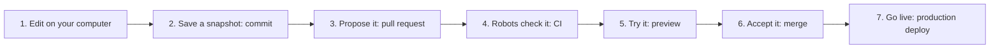

# How shipping works

When developers say "ship it", they mean a chain of steps that gets your change from
your computer to the people using your app, safely. AI coding tools will do most of
these steps for you, but you need to know what they are so you can tell when
something is wrong.

## The whole picture

## Each step in plain words

**1. Edit.** You, or your AI tool, change files on your computer. Nothing anyone else
sees has changed yet.

**2. Commit.** A commit is a saved snapshot with a note about what changed. *Git* is
the tool that keeps these snapshots, so you can always go back.

**3. Pull request (PR).** You put your changes on a separate copy, called a *branch*,
and ask to add them to the main version. A PR is a page that shows exactly what
changed. It is where mistakes get caught.

**4. CI (continuous integration).** Robots automatically run checks on your PR: do the
tests pass, does the app build, are there leaked passwords. A red X means stop and
read why.

**5. Preview.** Hosts like Vercel and Netlify build a private copy of your app for
each PR, with its own link. Click around it before anyone else sees the change.

**6. Merge.** You accept the PR into the main version.

**7. Production deploy.** The main version goes live for real users. Many hosts do
this automatically after a merge.

## Why bother with all this?

Because the alternative is editing the live app directly, and the first time your AI
tool deletes something important, there is no undo. Every step above is a chance to
catch a mistake before your users do.

## What to ask your AI coding tool

- "Create a new branch for this change and commit with a clear message."
- "Open a pull request and summarize what changed."
- "The CI check failed. Read the log and explain the error in plain words before
  fixing it."
- "Do not push to main directly."

The [agent skills](../skills/) teach your AI tool to do this without being asked.

## Next

[Rescue guides](06-rescue-guides.md)
