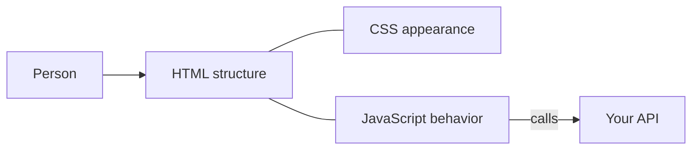

# Frontend

The frontend is the part a person sees and clicks. It runs in their browser, on
their computer. They can view it and change it. That is why it shows things and
sends asks, and why it never holds a secret or decides who is allowed to see a
row.

The browser understands HTML, CSS, and JavaScript. TypeScript is JavaScript with
types, and it becomes JavaScript before the browser runs it. Go, Rust, Python,
Ruby, and PHP do not run your screens. They can build the HTML on the server.
The page the person gets is still HTML, CSS, and JavaScript.

## How it works

## The pages

1. [HTML](html.md): the structure and the words
2. [CSS](css.md): layout and appearance
3. [JavaScript](javascript.md): behavior in the browser
4. [Languages](languages.md): JavaScript, TypeScript, and how to choose when the
   other languages are not browser languages
5. [Components](components.md): reusable pieces of a screen
6. [Handlers](handlers.md): the functions that run when someone clicks or submits

Framework perks (React, Vue, Angular, and the rest) are in
[frontend frameworks](../fullstack/04-frontend-frameworks.md).

HTTP methods such as `GET` and `POST` are not frontend methods. Those are in
[API methods](../api/methods.md).

When you know which screen stack you want, paste the matching file from
[prompts](../prompts/README.md). The prompt tells the AI the framework, the
language, and why, so the next chat does not switch stacks.
