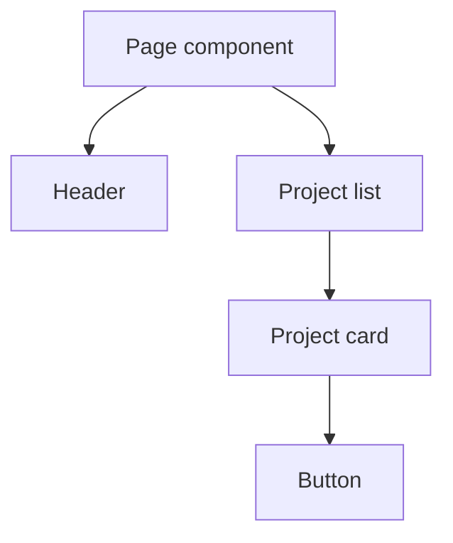

# Components

A component is a named piece of a screen you can use more than once: a button, a
price card, a navigation bar. Pages are components made of smaller components.
This is the main idea in React, Vue, Angular, and Svelte. The words differ. The
idea does not.

## How it works

**Props are the inputs.** A card receives a title and a price. It does not go
and look them up itself if the parent already has them. Passing data down keeps
one fact in one place.

**State is what the component remembers.** A menu remembers whether it is open.
The text in a search box can live here for a moment. The user's name, their
projects, and anything that must survive a refresh do not. Those live in the
database and arrive through the API.

**A component renders HTML.** If two screens need the same button, there is one
button component. Copying the markup means the next change happens once and looks
like it happened everywhere.

Build from the outside in: page, regions, then the piece that repeats. A list is
one component that renders many cards.

Leave one-off sentences as ordinary HTML. A component for every paragraph is a
maze.

Layout, color, and accessibility rules are in
[components, layout, and design](../fullstack/03-components-layout-and-design.md).
This page is the vocabulary. That page is the visual rules.

## Common mistakes

- **A component that fetches, saves, and also draws the button.** Split the
  visual piece from the piece that talks to the API, so the button can be reused
  on a screen that does not save.
- **Two components that each keep their own copy of the same fact.** They will
  disagree. One owner: the parent, or the server.
- **Props named `data`.** Name the thing. `project` and `onSave` tell the AI, and
  you, what the piece is for.

## What to tell your AI

"Build the screen as components. Props in, HTML out. Shared buttons and fields
live in one folder. Server data comes from the API, not from a secret inside the
component. Do not introduce a second component framework."

## Further reading

- [Thinking in React](https://react.dev/learn/thinking-in-react)
- [Handlers](handlers.md)
- [Frontend frameworks](../fullstack/04-frontend-frameworks.md)
