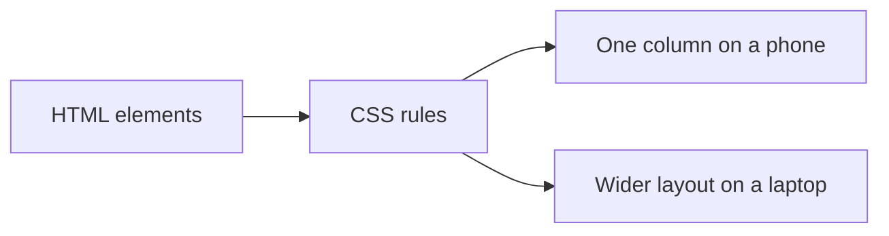

# CSS

CSS is how the page looks and how it arranges itself: color, type, spacing, and
layout. It is a language, and it is not a general-purpose programming language.
You do not build an API in CSS. You also do not skip it, because a component
framework does not design your app for you.

## How it works

A rule selects something (`button`, or a class you invented) and sets properties
(`color`, `padding`, `display`). The same rule can style every button. Copying
the same numbers onto every element is how a page drifts.

**Flexbox** lays things out in a row or a column. **Grid** lays them out in rows
and columns together. Those two cover almost every screen. Random margins are
what people use when they have not named which of the two they want.

**Responsive** means the same HTML adapts. A narrow window gets one column. A
wide window can get two. It does not mean a second website.

Pick one styling system:

- **Plain CSS**, a file of your own rules. Perk: nothing extra to install, and
  the browser is the documentation. Pick it when the visual language is small.
- **[Tailwind](https://tailwindcss.com/docs)**, small class names on the element
  (`mt-4` is a top margin). Perk: the style sits next to the markup, and AI tools
  have seen a lot of it. Pick it when you are vibe coding a product UI.

Do not add a third system beside the one you picked.

A handful of spaces (4, 8, 16, 24, 32) and one accent color for actions will look
more finished than a new palette on each page. Text has to be readable on the
background. State is never color alone: "Error" plus a border, not only red.

## Common mistakes

- **A new set of colors on each screen.** Name the colors once, in the first
  prompt.
- **Pixel-pushing instead of a layout rule.** Ask which Flexbox or Grid property
  is wrong.
- **Designing only at desktop width.** Check about 375 pixels wide.

## What to tell your AI

"One styling system: `<Tailwind or plain CSS>`. Shared spacing and one accent
color. Flexbox or Grid for layout. The main task works at 375 pixels wide and at
a laptop width."

## Further reading

- [MDN: CSS](https://developer.mozilla.org/en-US/docs/Web/CSS)
- [web.dev: Learn CSS](https://web.dev/learn/css)
- [Tailwind docs](https://tailwindcss.com/docs)
- [JavaScript](javascript.md)
