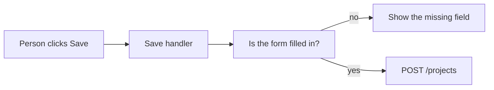

# Handlers

A handler is a function that runs when something happens. On the frontend, that
something is an event in the browser: a click, a submit, a change in a text
field, the page finishing loading. People also say "method" for a function that
belongs to an object. Neither word means HTTP `GET` or `POST`. Those are
[API methods](../api/methods.md), and they run on the server.

## How it works

The handler's job on the frontend is small:

1. Read what the person entered.
2. If a field is empty, show that next to the field. This is a courtesy. The
   server checks again.
3. Call the endpoint that actually saves.
4. Show a busy state while the request is in flight, then show the result or the
   error sentence.

A handler should not check a password, write a row, or decide that this person
owns a project. By the time the handler runs, the person already has the page.
Anyone can call the endpoint without your button.

**Form handlers** are the important ones. Submit is the event. The handler
either lets the browser do a normal form post (a good default, especially with
HTMX or a full-stack framework) or it sends the request itself and updates the
page. Pick one. Doing both creates double saves.

**Naming.** `onSave` and `handleSubmit` are fine. `doStuff` is how a later
session attaches a second behavior to the wrong click.

## Common mistakes

- **The real check lives only in the handler.** An empty-title check in the
  browser is nice. The API still rejects an empty title.
- **No busy state.** People click twice. Disable the button or ignore the second
  submit until the first response arrives.
- **Calling a write endpoint from a handler attached to page load.** Loading a
  page should be a read. Saves happen because the person asked.

## What to tell your AI

"Click and submit handlers only call our API and update the screen. Validation
in the handler is a courtesy. The server repeats it. Do not put auth or database
calls in a browser handler. One submit must not create two rows."

## Further reading

- [MDN: Events](https://developer.mozilla.org/en-US/docs/Learn_web_development/Core/Scripting/Events)
- [MDN: Event](https://developer.mozilla.org/en-US/docs/Web/API/Event)
- [API methods](../api/methods.md)
- [Backend handlers](../backend/handlers.md)
