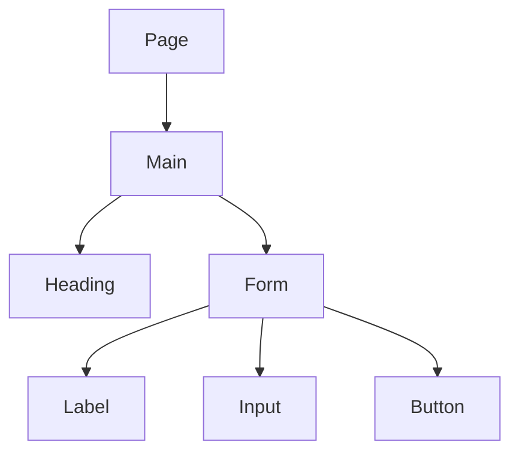

# HTML

HTML is the structure of a page: what the pieces are, in what order. A heading, a
paragraph, a link, a form, a button. CSS makes that structure look like a design.
JavaScript makes it react. If the HTML is wrong, the CSS and the framework are
decorating the wrong thing.

## How it works

You write tags. `<h1>` is the page title. `
` is a paragraph. `<a>` is a link.
`<form>` wraps fields that will be sent somewhere. `<label>` names a field.
`<input>` is the field. `<button>` is something you activate.

The browser builds a tree from these tags. Screen readers walk that tree.
Search engines read it. A styled `
` that only looks like a button is a
picture of a button. Use `<button>` when the person is doing an action on this
page, and `<a>` when they are going to another page.

Headings go in order. One `h1`, then `h2`, then `h3`. Skipping levels makes the
outline lie.

Images need a text alternative (`alt`) that says what the image is for. Decorative
images can have empty alt text. A form field without a label is a box a lot of
people cannot identify.

Frameworks still produce HTML. When a React or Vue screen is wrong for a keyboard
user, the fix is usually the HTML the component renders, not a new library.

## When to care

Care on every screen, including screens a framework generated. Look at the page
and ask: if I could not see the colors, would the structure still say what this
is?

## Common mistakes

- **Divs for every control.** Buttons, links, and labels already exist.
- **Clickable headings.** A heading is not a button. Put a button or a link in
  the heading if it should do something.
- **Placeholder as the label.** The placeholder disappears when someone types.
  The label stays.

## What to tell your AI

"Use semantic HTML. One h1. Every input has a label tied to it. Actions are
button elements. Navigation is links. Do not replace those with divs."

## Further reading

- [MDN: Structuring content](https://developer.mozilla.org/en-US/docs/Learn_web_development/Core/Structuring_content)
- [MDN: HTML elements](https://developer.mozilla.org/en-US/docs/Web/HTML/Reference)
- [CSS](css.md)
