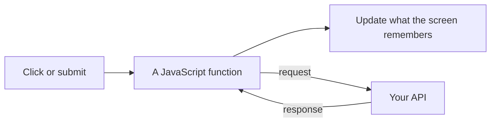

# JavaScript

JavaScript is the programming language the browser runs. It is what happens after
the page is showing: a click, a typed character, a response coming back from your
API. HTML is the structure. CSS is the look. JavaScript is the behavior.

The same language can run on a server with Node.js. That is a backend topic.
This page is the browser copy. Anything that ships to the browser is public.
Secrets, database URLs, and "is this person allowed?" do not go here.

## How it works

You will see a few words constantly:

- A **variable** holds a value, such as the text in a search box.
- A **function** is a named chunk of behavior. A function that runs because
  something happened is a [handler](handlers.md).
- An **array** is a list. An **object** is a set of labeled values. JSON, the
  text format APIs speak, looks like objects and arrays.
- **Async** means "this will finish later". A request to your API is async. The
  page should show a busy state, and it should handle the failure, not only the
  success.

The browser gives JavaScript the page as a tree of elements (the DOM) and a
stream of events. Frameworks such as React sit on top of that so you describe
the screen and they update the tree. You can write the DOM calls yourself. You
usually should not, once the app has more than a little behavior. The
[languages page](languages.md) is how JavaScript relates to TypeScript and to
Go, Rust, and the rest.

## When you are looking at browser JavaScript

You are in the frontend when the code:

- reads a click, a key, or a form
- shows and hides parts of the page
- calls your API and renders what came back

You have left the frontend when the code reads `DATABASE_URL` or checks a
password. That code stays on the server even if it is also JavaScript.

## Common mistakes

- **Fetching secrets from the browser.** The request is visible in the developer
  tools. The server makes the call that needs a key.
- **Trusting a check that only runs here.** Hiding a button does not stop anyone
  from calling the API.
- **No failure path.** The request will fail on a bad network. Show the error
  your API returned.

## What to tell your AI

"Browser JavaScript handles events and calls our API. It does not import the
database, it does not read secrets, and it does not decide authorization. Show a
busy state and the error sentence from the response."

## Further reading

- [MDN: JavaScript](https://developer.mozilla.org/en-US/docs/Learn_web_development/Core/Scripting)
- [MDN: Events](https://developer.mozilla.org/en-US/docs/Learn_web_development/Core/Scripting/Events)
- [Languages](languages.md)
