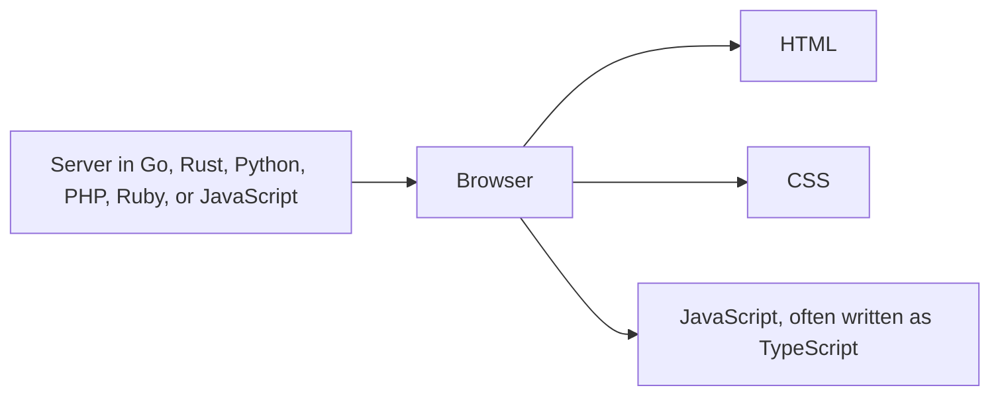

# Frontend languages

The browser runs JavaScript. HTML and CSS sit beside it. They are the three
languages of a screen. Choosing a backend language does not change that. A Go
server, a Rust server, a Python server, and a PHP server all end up sending
HTML, CSS, and JavaScript to the person.

## How it works

**HTML** says what the pieces are. **CSS** says how they look. Neither one is the
language you write account rules in. Both are required. Skipping them and asking
for "a nice UI" produces a different look on every page.

**JavaScript** is the programming language of the page. Perk: it is the one the
browser already speaks, so there is no plugin and no translation step for the
visitor. It is also, with Node.js, a server language, which is why one project
can use it in both places. Cost: it is easy to put server work in the file that
ships to the visitor. The file boundary has to be a rule you state.

**TypeScript** is JavaScript plus types. A type names the shape of a value: a
user has an `id` and an `email`, and a function that forgets the email fails
before the app runs. Perk: your AI tool is less free to invent fields, because
the build complains. Cost: a compile step, and occasional fights with the
compiler. For an app you will keep editing with an AI, TypeScript is the default
browser language. The [TypeScript docs](https://www.typescriptlang.org/docs/)
start from scratch in the
[handbook](https://www.typescriptlang.org/docs/handbook/typescript-from-scratch.html).

**Other languages in the browser.** Projects can compile other languages to WebAssembly
and run that beside JavaScript. That is a specialist tool. It is not how you
build a login screen. If a prompt suggests Rust or Go for a button, it has
confused the server with the browser.

## How to choose

| Goal | Language on the screen |
| --- | --- |
| A product an AI will keep editing | TypeScript |
| A one-page site with almost no behavior | HTML and CSS, maybe a few lines of JavaScript |
| You want HTML-like templates | Still TypeScript or JavaScript, inside Vue or Svelte |
| You want the server to send HTML and little JavaScript | HTML and CSS, with HTMX. The programming language is the backend's. |
| You like Go, Rust, Python, Ruby, or PHP | Use that language on the server. The screen is still HTML, CSS, and JavaScript. |

The framework choice (React, Vue, Angular, Svelte) is which kit organizes the
JavaScript. It is the next decision, and it is already made in
[choose your stack](../fullstack/13-choose-your-stack.md). Language first: if it
runs in the browser and the app has real behavior, TypeScript.

## Common mistakes

- **Picking Go or Rust "for the frontend" because they are fast.** The visitor's
  bottleneck is the network and the design, not the language that rendered a
  button. Those languages earn their place on the server. See
  [backend languages](../backend/languages.md).
- **Plain JavaScript on a large app "to keep it simple".** The simplicity
  disappears the week the AI adds a field that does not exist. Types are the
  simpler choice over time.
- **Three styling languages plus two component frameworks.** One component
  language, one styling system.

## What to tell your AI

"The browser language is TypeScript. HTML is semantic. Styling is `<Tailwind or
plain CSS>` only. Do not compile Go, Rust, or Python into the page. Do not put
server secrets in a file that ships to the browser."

## Further reading

- [TypeScript docs](https://www.typescriptlang.org/docs/)
- [MDN: JavaScript](https://developer.mozilla.org/en-US/docs/Learn_web_development/Core/Scripting)
- [Backend languages](../backend/languages.md), including Go and Rust
- [Prompts](../prompts/README.md)
