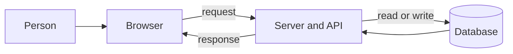

# The shape of a web app

A web app is three programs that talk to each other. The browser shows the screen.
The server applies the rules. The database remembers. If you can point at those
three, you can direct an AI to build one.

## How it works

**The browser is the client.** It downloads your pages and runs them on the
visitor's computer. It can show things and remember a little, but a visitor can
change anything that runs there. Treat the browser as untrusted. Real rules live
on the server.

**The server is the backend.** It stays on, on a host you rent, and answers
requests. A request is one ask: "show this page" or "save this order". The answer
is a response. The conversation follows [HTTP](https://developer.mozilla.org/en-US/docs/Web/HTTP/Reference/Methods),
the shared rules browsers and servers already speak.

**An API is the set of asks your server accepts.** Each ask has an address, called
an endpoint. `POST /orders` means "create an order". The browser, and later a phone
app, can use the same API. Details are in
[APIs and endpoints](07-apis-and-endpoints.md).

**The database is the memory of the product.** Refreshing the page does not clear
it. Accounts, orders, and posts live there. Your server talks to it. The browser
never should. Details are in [Databases](08-databases.md).

**The frontend is everything the person sees.** It is built from
[HTML, CSS, and JavaScript](02-html-css-and-javascript.md), usually with a
[framework](04-frontend-frameworks.md) so you are not hand-building every screen.

**Full stack means you own all three.** A full-stack framework such as Next.js
puts the frontend and the server in one project. A split stack puts React in one
project and Express in another. Both are full stack. The split is a packaging
choice, explained in [choose your stack](13-choose-your-stack.md).

A click that saves something takes this path every time:

1. The person uses a component, such as a button.
2. The browser sends an HTTP request to an endpoint.
3. The server checks who they are ([authentication](09-authentication.md)) and
   whether this action is allowed.
4. The server checks the input, then reads or writes the database.
5. The server sends a response. The browser updates the screen.

Skip step 3 or 4 and the app can still look finished. It is not safe to put online.
[Security](10-security.md) is those steps, written as checks.

## When to use this picture

Use it before you name a framework. React, Vue, Angular, Express, and Next.js are
all ways to build the boxes above. They are not extra boxes.

Also use it when the AI starts adding pieces you did not ask for: a second
database, a cache, a queue, a separate admin app. Ask which box it belongs in. If
it does not change what the person can do, you probably do not need it yet.

## Common mistakes

- **Putting rules only in the browser.** Hiding a button does not stop anyone from
  calling the endpoint. The server repeats the check.
- **Letting the browser talk to the database.** The connection string is a secret.
  It stays on the server.
- **Starting with five services.** One app, one database, and a host is enough for
  the first version. Add a piece when a real limit shows up.

## What to tell your AI

"Use one web project and one Postgres database. The browser never holds secrets
and never connects to the database. Every save goes through an endpoint that checks
who the user is."

## Further reading

- [MDN: How the web works](https://developer.mozilla.org/en-US/docs/Learn_web_development/Getting_started/Web_standards/How_the_web_works)
- [MDN: HTTP methods](https://developer.mozilla.org/en-US/docs/Web/HTTP/Reference/Methods)
- Next page: [HTML, CSS, and JavaScript](02-html-css-and-javascript.md)
