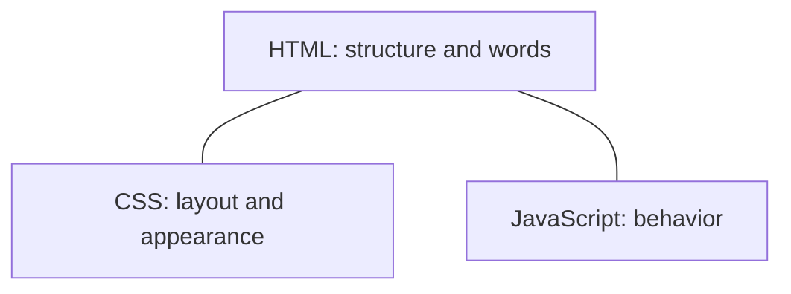

# HTML, CSS, and JavaScript

Every website, including ones built with React or Vue, ends up as three languages
the browser understands. Frameworks write them for you. You still need the names,
because errors and tutorials use them, and because you will sometimes tell the AI
to fix the HTML rather than the framework.

## How it works

**HTML marks up the structure.** A heading, a paragraph, a link, a form, a button.
The tags are the labels: `<button>`, `<form>`, `<input>`. Screen readers and search
engines read this structure. A clickable `
` with no role is a button that
some people cannot use. Ask for real elements.

**CSS controls appearance.** Color, type, spacing, and layout live here. A separate
rule can say "every button looks like this" without copying styles onto each
button. Layout on the modern web is mostly Flexbox (a row or a column) and Grid
(rows and columns together).

**JavaScript makes the page react.** It runs when someone clicks, types, or when
the page needs data from your API. The same language can run on a server with
[Node.js](https://nodejs.org/en/about). That is why one full-stack project can use
JavaScript in the browser and on the server. The browser version must not contain
secrets. Anyone can open the developer tools and read it.

A framework component is still these three. A React button compiles down to an HTML
button, some CSS, and some JavaScript. When a screen looks wrong, the bug is in one
of those layers: missing structure, a bad layout rule, or behavior that ran at the
wrong time.

## When to use each

| You want | You touch |
| --- | --- |
| The right words, headings, forms, and buttons | HTML |
| Spacing, color, type, and a layout that fits a phone | CSS |
| A click that calls your API and updates the page | JavaScript |
| All three, organized as reusable pieces | A framework, next page |

You do not pick HTML *or* React. React produces HTML.

**Plain CSS or Tailwind.** Plain CSS is a file of rules you write yourself.
[Tailwind](https://tailwindcss.com/docs) is a long list of small class names you
put on the element (`mt-4` means a top margin). Tailwind is a good default for
vibe coding because the style sits next to the markup and the AI has seen a lot of
it. Plain CSS is a good default when you want a small set of rules and no extra
tool. Do not add a third styling system beside whichever one you picked.

## Common mistakes

- **Divs for everything.** Use `<button>`, `<a>`, `<label>`, `<nav>`, `<main>`,
  and headings in order. Accessibility starts here, not in a later polish pass.
- **Fixing layout with random margins.** Ask the AI which Flexbox or Grid rule is
  wrong. Guessing pixel values stacks up.
- **Fetching secret data in browser JavaScript.** Calls from the browser are
  public. The server makes the call that needs a key.
- **One giant file of JavaScript.** Behavior belongs next to the component that
  uses it.

## What to tell your AI

"Use semantic HTML, one styling system, and no secrets in browser code. Labels are
tied to inputs. The page has one `h1`. It still works if I tab through it without
a mouse."

## Further reading

- [MDN: Structuring content with HTML](https://developer.mozilla.org/en-US/docs/Learn_web_development/Core/Structuring_content)
- [MDN: HTML elements](https://developer.mozilla.org/en-US/docs/Web/HTML/Reference)
- [MDN: CSS](https://developer.mozilla.org/en-US/docs/Web/CSS)
- [web.dev: Learn CSS](https://web.dev/learn/css)
- [MDN: JavaScript](https://developer.mozilla.org/en-US/docs/Learn_web_development/Core/Scripting)
- [Tailwind docs](https://tailwindcss.com/docs)
- Next page: [Components, layout, and design](03-components-layout-and-design.md)
