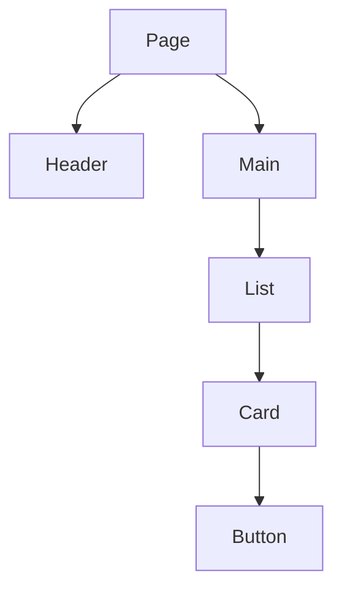

# Components, layout, and design

A component is a piece of the screen you can reuse and name: a button, a price
card, a nav bar. Design is how those pieces are arranged so a person can tell what
to do. You do not need a design degree. You do need a small set of rules, or the
AI will invent a new style on every page.

## How it works

**A component has three ideas.**

- **What it shows.** The HTML inside it.
- **What you pass in.** Its inputs. A `PriceCard` receives a name and a price. In
  React those inputs are called props. Other frameworks have the same idea under
  other names.
- **What it remembers.** State. A menu that is open or closed, the text in a search
  box. State that must survive a refresh belongs in the database, not in the
  component.

**Build from the outside in.** Page, then regions, then the repeated piece. A list
of cards is one component that renders many cards. Copy-pasting the card markup
ten times means the next change happens nine times too few.

**Layout.** Decide a page width, a small set of spaces (4, 8, 16, 24, 32 pixels is
enough), and a type scale (a size for body text, a size for headings). Put the
primary action in one obvious place. Phones get one column. Wider screens can get
two. This is responsive design: the same page adapts. It is not a second website.

**Color and type.** Pick one accent color for actions, a neutral background, and a
text color dark enough to read. Do not communicate state by color alone. A red
border plus the word "Error" still works for someone who does not see the red.

**Forms.** Every input has a visible label. Errors sit next to the field they
belong to. The submit button says what will happen ("Create account"), and it
shows a busy state so people do not click twice.

## When to use a component

Make a component when the same markup appears twice, or when a piece has a name a
teammate would use ("the upgrade banner"). Leave one-off text as ordinary markup.
A component for every paragraph is how a small page becomes a maze.

Shared pieces for almost every app: header, footer, button, text field, card, empty
state ("no projects yet"), and error state.

## Common mistakes

- **A new visual style on each screen.** Write the spacing, colors, and button
  style once, in the first prompt, and point later prompts at it.
- **State in the wrong place.** The open menu can live in the component. The user's
  name comes from the server. If two components can disagree about the same fact,
  one of them should be reading it from the other, or both from the server.
- **Placeholder buttons.** "Click here" and icon-only buttons without a text label
  fail keyboard and screen-reader use.
- **Designing only at desktop width.** Look at the page at about 375 pixels wide
  before you call it done.

## What to tell your AI

"Components receive data through props and do not fetch inside a purely visual
piece. One `h1` per page. Labeled inputs. A primary button style used everywhere.
Layout works at 375 pixels wide and at a laptop width. Follow
[the WAI intro](https://www.w3.org/WAI/fundamentals/accessibility-intro/): real
buttons, visible focus, and text that does not depend on color alone."

## Further reading

- [MDN: Accessibility](https://developer.mozilla.org/en-US/docs/Learn_web_development/Howto/Design_and_accessibility)
- [WAI: Introduction to accessibility](https://www.w3.org/WAI/fundamentals/accessibility-intro/)
- [Thinking in React](https://react.dev/learn/thinking-in-react) (the component
  breakdown works even if you do not pick React)
- Next page: [Frontend frameworks](04-frontend-frameworks.md)
