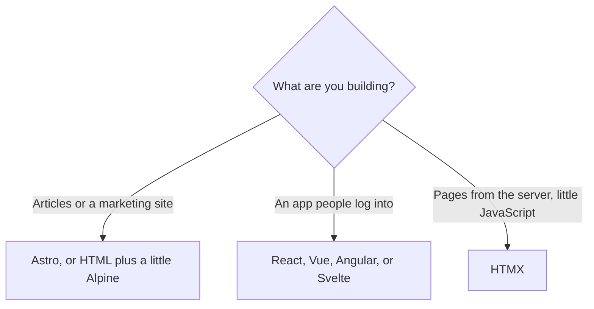

# Frontend frameworks

A frontend framework is the kit that turns your screens into a website the browser
can run. It gives you components, a way to update the page when data changes, and
usually a router so `/settings` is a real page. It does not save data and it does
not sign people in. Those stay on the server.

You can ship with plain HTML, CSS, and JavaScript. Pick a framework when the app
has many screens that update in place. For a logged-in product, that is almost
always.

## How it works

The perks below are the reason to pick one. Popularity matters too: the framework
your AI tool has seen the most will get you to a working app with fewer invented
APIs. In practice that is React, then Vue. Choose a less common one when its perk
matches the app, and point the AI at that framework's docs with an MCP server.

## React

[React](https://react.dev/learn) is a library for components. You describe the
screen as a function of your data. When the data changes, React updates the parts
that depend on it. The syntax is JSX: HTML-like tags inside JavaScript.

**Perks.** The largest set of examples, component libraries, and hiring familiarity.
Next.js, Remix, and React Router are built on it. AI tools are strongest here.

**Pick it when** you are building a product and you do not have a reason to pick
something else. Pair it with a full-stack framework rather than assembling routing
and data loading yourself. Start with [Thinking in React](https://react.dev/learn/thinking-in-react).

**Cost.** React itself is only the screen. Routing, data fetching, and a server are
choices you add, or you let Next.js choose them.

## Vue

[Vue](https://vuejs.org/guide/introduction.html) is a framework with an official
router and an official store. Templates look like HTML with a few extra attributes.
That is easier to read than JSX if you are coming from a page, not from JavaScript.

**Perks.** A gentle learning curve, excellent docs, and one recommended way to do
routing and shared state. [Nuxt](https://nuxt.com/docs/getting-started/introduction)
is the full-stack version. The [quick start](https://vuejs.org/guide/quick-start.html)
is short enough to read once.

**Pick it when** you want an app framework that feels like HTML, or you already
like Vue's docs more than React's.

**Cost.** Fewer third-party examples than React, so an AI is a little more likely
to guess an outdated API. Keep the official docs connected.

## Angular

[Angular](https://angular.dev/overview) is a full frontend platform. Routing, forms,
HTTP calls, and a strong structure come in the box. It is TypeScript by default:
JavaScript with types the editor can check.

**Perks.** One official way to build a large app. Good for products that will be
maintained for years by more than one person. The
[tutorials](https://angular.dev/tutorials/learn-angular) are the path in.

**Pick it when** the app is large, the team wants strict structure, or you are
matching an existing Angular codebase.

**Cost.** More concepts on day one (modules of ideas: components, services,
dependency injection). A small weekend app feels the weight. AI tools know Angular,
and they also mix examples from older Angular versions. Pin the docs.

## Svelte

[Svelte](https://svelte.dev/docs/svelte/overview) components look like HTML, CSS,
and JavaScript in one file. Svelte compiles them ahead of time into plain
JavaScript, so the browser does less work to keep the screen updated.

**Perks.** Little boilerplate. Fast pages. The writing in the docs is unusually
clear. [SvelteKit](https://kit.svelte.dev/docs/introduction) adds routing and a
server.

**Pick it when** you want a small, fast app and you are willing to point the AI at
SvelteKit's docs because it has seen fewer Svelte apps than React apps.

**Cost.** A smaller ecosystem. Some UI kits you see in tutorials are React-only.

## Solid

[Solid](https://docs.solidjs.com/) looks similar to React and updates only the
exact piece of the page that changed, which keeps large screens fast.

**Perks.** React-like components without rerendering the whole component to change
one value. A good fit for data-heavy screens.

**Pick it when** you have measured that React is too slow for a particular screen,
or you already prefer Solid. It should not be your first framework just because a
benchmark won.

**Cost.** Far fewer examples for an AI to copy correctly.

## Qwik

[Qwik](https://qwik.dev/docs/) is built so a page can become interactive without
downloading the whole app first. It resumes work instead of booting the entire
JavaScript bundle.

**Perks.** Very fast first load on content that is also an app.

**Pick it when** first-load speed on a large app is the main problem and you accept
a newer tool with fewer examples.

**Cost.** Newer, so tutorials and AI output drift. Keep the docs attached.

## HTMX and Alpine

[HTMX](https://htmx.org/docs/) lets the server return a snippet of HTML, and the
page swaps that snippet in. You stay in HTML. The server renders the new piece.
[Alpine.js](https://alpinejs.dev/) is the small cousin for local behavior: open a
menu, toggle a field, without a framework.

**Perks.** Much less JavaScript. A Python, Ruby, PHP, or Go server can own the
screens. Easy to see what the app is doing.

**Pick it when** the app is mostly forms and pages, and you do not need a rich
client that rearranges itself constantly.

**Cost.** A highly interactive screen (a live board, a complex editor) fights the
model. Use a component framework for that part, or for the whole app.

## Astro

[Astro](https://astro.build/docs) is for content sites: marketing pages, docs,
blogs. It ships as little JavaScript as it can. Interactive islands can be React,
Vue, Svelte, or Solid components inside an otherwise quiet page.

**Perks.** Fast content sites, and you are not locked to one component framework
for the islands.

**Pick it when** most of the site is reading, with a widget or two. For an app
that is almost all logged-in interaction, use a full-stack app framework instead.

## A choice you can defend

| Your situation | Start here |
| --- | --- |
| A product, and no existing codebase | React, inside Next.js |
| You want HTML-like templates | Vue, inside Nuxt |
| A large app that should be strict | Angular |
| You want less tooling and small components | Svelte, inside SvelteKit |
| Mostly reading, not a logged-in product | Astro |
| Forms and pages, server renders HTML | HTMX |
| You are matching a repo that already chose | That framework |

Solid and Qwik are real options. They are second choices for a first app you are
vibe coding, because a wrong guess from the AI costs more when the examples are
thin.

## Common mistakes

- **Picking from a benchmark chart.** The cost of a framework for you is wrong
  code from the AI and outdated blog posts, not a millisecond of render time.
- **Using two frameworks in one app.** Astro islands aside, one component model
  per app.
- **Adding a framework to a one-page site.** HTML and CSS are enough for a page
  that does not change.

## What to tell your AI

"The UI framework is `<the one you picked>`. Do not introduce a second one. Follow
its current docs, not a two-year-old tutorial. Components get their data from
props or from the server, not from a secret in the browser."

## Further reading

- [React quick start path](https://react.dev/learn)
- [Vue guide](https://vuejs.org/guide/introduction.html) and [quick start](https://vuejs.org/guide/quick-start.html)
- [Angular overview](https://angular.dev/overview)
- [Svelte overview](https://svelte.dev/docs/svelte/overview)
- [Solid docs](https://docs.solidjs.com/)
- [Qwik docs](https://qwik.dev/docs/)
- [HTMX docs](https://htmx.org/docs/)
- [Alpine](https://alpinejs.dev/)
- [Astro docs](https://astro.build/docs)
- Next page: [Full-stack frameworks](05-fullstack-frameworks.md)
