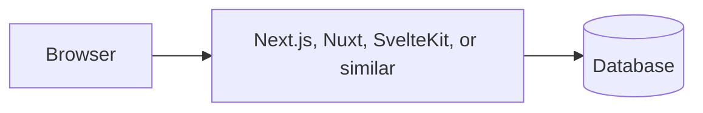

# Full-stack frameworks

A full-stack framework gives you the screens and the server in one project. You
get pages, a place to put endpoints, and a story for deploying. This is the usual
shape for a vibe-coded product. A separate Express server is the right shape when
several clients must share one API. That choice is the next page.

## How it works

The framework runs some of your code on the server (so secrets stay there) and
sends HTML and JavaScript to the browser. In Next.js, a file that handles a click
in the browser is marked so its code is allowed to ship to the visitor. A file
that reads the database is not. If a secret shows up in a browser file, the
framework will not save you. You, or your checklist, will.

## Next.js (React)

[Next.js](https://nextjs.org/docs) is the full-stack framework around React. The
current docs teach the App Router: folders are URLs, `page` files are screens, and
route handlers are endpoints.

**Perks.** One project for UI and API. File-based routing. A deploy path that
[Vercel](https://vercel.com/docs) understands on contact, and that other hosts run
too. The deepest pile of working examples for AI tools. Server code and browser
code are separated if you follow the docs.

**Pick it when** you are building a logged-in product in JavaScript and you do not
already have a stack. This is the default in
[choose your stack](13-choose-your-stack.md).

**Cost.** The App Router has its own rules (server components, when a component
runs in the browser). Old tutorials still show the Pages Router. Tell the AI to
follow the [App Router getting started](https://nextjs.org/docs/app/getting-started)
guide and ignore Pages Router posts.

## Nuxt (Vue)

[Nuxt](https://nuxt.com/docs/getting-started/introduction) is the same idea for
Vue: file-based pages, server routes, one deploy.

**Perks.** Vue's HTML-like templates, plus a server. A clear official path.

**Pick it when** you chose Vue on the previous page.

**Cost.** Fewer copy-paste production examples than Next.js. Keep Nuxt's docs in
your MCP server.

## SvelteKit (Svelte)

[SvelteKit](https://kit.svelte.dev/docs/introduction) is that path for Svelte.
Load data on the server, post forms to the server, ship a small page.

**Perks.** Small components, a coherent server story, fast pages.

**Pick it when** you chose Svelte and you want routing and data loading included.

**Cost.** Same ecosystem warning as Svelte. Pin the docs.

## React Router (this used to be called Remix)

[React Router's framework mode](https://reactrouter.com/start/framework/installation)
is the current home of Remix. You think in web fundamentals: a route loads data, a
form posts to the server, and the HTML that comes back is the update.

**Perks.** Forms, errors, and loading states follow the platform instead of a
custom client cache. A strong choice when you want the server to own each screen's
data.

**Pick it when** you like that model, or a tutorial you trust is written for Remix.
Read it as React Router now.

**Cost.** Names are in flux. "Remix", "React Router v7", and "framework mode" are
the same family. Say which docs you mean in the prompt.

## Astro, again

Astro can run server endpoints too. Use it for a content site that needs a form
and a small API. Use Next, Nuxt, or SvelteKit when the product *is* the app.

## Rails, Laravel, and Django

These are full-stack frameworks in other languages. Each one is "batteries
included": pages, database tools, and a place for sign-in, with strong opinions
that keep a large app consistent.

**Ruby on Rails.** [Rails](https://guides.rubyonrails.org/getting_started.html)
made "convention over configuration" famous. If you follow its folder names, a lot
of behavior is already decided. Perk: you ship a database-backed app very quickly
once you accept the conventions. Pick it when you want one mature Ruby stack and
you will hold the AI to the official guides.

**Laravel (PHP).** [Laravel](https://laravel.com/docs) is the Rails-like stack for
PHP. Perk: a huge ecosystem for business apps, queues, and mail, and PHP is cheap
to host. Pick it when you are already in PHP or your host is.

**Django (Python).** [Django](https://docs.djangoproject.com/en/stable/intro/overview/)
includes an admin site, a database layer, and auth opinions. Perk: the admin is a
real time saver, and Python is the language most data and machine-learning tools
speak. Pick it when the rest of your work is Python.

**The shared cost.** AI tools have seen fewer complete apps in these than in
Next.js, and each framework is strict. A guess that ignores the convention creates
a mess faster than in a loose JavaScript project. Connect that framework's docs
before you generate the app.

## When to use one

Use a full-stack framework for the first version of almost every web product. You
get one folder, one deploy, and one place to read.

Split the backend out when a second client needs the same rules: a phone app, a
partner, or a second website. You can still start in Next.js and add those
endpoints. You do not have to begin with two repositories.

## Common mistakes

- **Following a tutorial from the previous major version.** Name the version and
  link the current getting-started page in the prompt.
- **Putting database calls in browser components.** If the file is shipped to the
  browser, it cannot hold the database URL.
- **Adding Redis, a second framework, and a microservice on day one.** One app, one
  database, until something real forces the next piece.

## What to tell your AI

"Use `<Next.js App Router | Nuxt | SvelteKit | React Router framework | Rails | Laravel | Django>`.
Current docs only. Server-only code reads the database. Browser code calls our
endpoints. Do not add services I did not name."

## Further reading

- [Next.js docs](https://nextjs.org/docs) and [App Router getting started](https://nextjs.org/docs/app/getting-started)
- [Nuxt introduction](https://nuxt.com/docs/getting-started/introduction)
- [SvelteKit introduction](https://kit.svelte.dev/docs/introduction)
- [React Router framework installation](https://reactrouter.com/start/framework/installation)
- [Rails getting started](https://guides.rubyonrails.org/getting_started.html)
- [Laravel docs](https://laravel.com/docs)
- [Django overview](https://docs.djangoproject.com/en/stable/intro/overview/)
- Next page: [Backends, including Express](06-backends-and-express.md)
