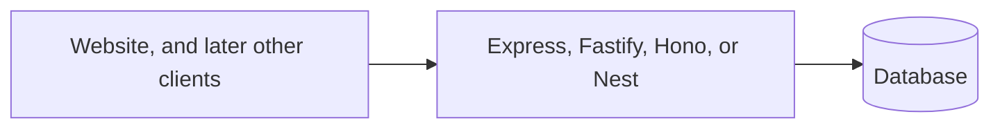

# Backends, including Express

The backend is the code that runs on a server: endpoints, rules, and the database
connection. A full-stack framework includes one. This page is for when that code
is its own project, and for the ideas you still need when it is not. Express is
the one to understand first, because the others are reactions to it, and because
a Next.js route handler is the same shape as an Express endpoint.

## How it works



A request comes in. A stack of functions runs before your handler. Those functions
are middleware: "require a signed-in user", "read the JSON body", "stop this
client if it is calling too fast". Then your function does the job and sends a
status code and a body.

[Node.js](https://nodejs.org/en/learn/getting-started/introduction-to-nodejs) is
what lets JavaScript run on the server. Express and the others on this page are
libraries on top of it.

The browser talks to this process over HTTP. The process talks to the database
with a connection string it reads from an environment variable. That string never
appears in frontend code.

## Express

[Express](https://expressjs.com/) is a small router. You say which method and path
you handle, and you send the response. It does not include a database, auth, or a
validator. You add those.

**Perks.** Short, famous, and everywhere in tutorials. If you can read an Express
handler, you can read most Node APIs. The
[install guide](https://expressjs.com/en/starter/installing.html) is a few lines.

**Pick it when** you want a separate API, the API is not huge, and you want the
AI to have the most examples to copy.

**Cost.** Express will not stop you from skipping validation, auth, or a sane
folder layout. You have to ask for those. It is also the oldest of this group.
That is fine. It is not a reason to avoid it.

A handler looks like this. The shape matters more than the syntax:

```js
app.post("/orders", requireUser, async (req, res) => {
  const input = checkOrder(req.body); // reject bad input here
  const order = await db.order.create({ ...input, userId: req.user.id });
  res.status(201).json(order);
});
```

`requireUser` and `checkOrder` are the product. The route line is plumbing.

## Fastify

[Fastify](https://fastify.dev/) is a Node server in the same family as Express,
with a schema for each route so bad input fails before your code runs, and with
a stronger speed story.

**Perks.** Validation is part of the route, not an extra you might forget. A good
step up when you want Express-like code with more guardrails.

**Pick it when** you are starting a new separate API and you want schemas from
the first route.

**Cost.** Slightly fewer beginner tutorials than Express. The official docs are
enough.

## Hono

[Hono](https://hono.dev/) is a very small router that runs on Node and on several
edge and serverless hosts. The code looks like Express.

**Perks.** One style of route that deploys in many places. Light enough that the
whole API stays readable.

**Pick it when** you want a small separate API, especially if the host is not a
long-running Node server.

**Cost.** Newer than Express. Pin the docs.

## NestJS

[NestJS](https://docs.nestjs.com/) puts an Angular-like structure on a Node API:
modules, classes, and dependency injection. It often runs on Express or Fastify
underneath.

**Perks.** A place for everything once the API is large. Teams can split work
without inventing a layout.

**Pick it when** several people will own the API, or the API has many modules and
you want the structure chosen for you.

**Cost.** A lot of ceremony for a five-endpoint app. Skip it for a first product
unless you already know you want that structure.

## How this sits next to Next.js

Next.js route handlers are endpoints inside the same project as the pages. Use
them while the website is the only client.

Start a separate backend when:

- a second client (a phone app, a partner) must call the same rules
- a long-running process does work that a short web request should not (heavy
  exports, scheduled jobs)
- you want to deploy the API on a different cadence from the website

Until one of those is true, a second server is a second thing to secure and pay
for.

If you already know a mobile app is coming, keep the rules on the server from the
first week. Those rules can live in Next.js route handlers. Moving them to Express
later is a packaging change if the rules were never hidden in the React code.

## Common mistakes

- **A backend with no auth middleware, plus "we will add it later".** Later is
  after someone reads another customer's rows. Put the check on the route now.
- **Trusting the user id sent in the body.** The server decides who the caller is
  from the session. The body can claim anything.
- **One file that is the entire company.** Group routes by resource (`orders`,
  `accounts`). Shared checks live in middleware, not copied into every handler.
- **Running Express and Next.js because a template did.** One of them should own
  the API.

## What to tell your AI

"If the website is the only client, put endpoints in the full-stack framework. If
I said the API is separate, use `<Express | Fastify | Hono | NestJS>`. Every route
that reads or writes a person's data runs an auth check first. Validate input on
the server. Read the database URL from an environment variable."

## Further reading

- [Node.js introduction](https://nodejs.org/en/learn/getting-started/introduction-to-nodejs)
- [Express](https://expressjs.com/) and the [starter install](https://expressjs.com/en/starter/installing.html)
- [Fastify](https://fastify.dev/)
- [Hono](https://hono.dev/)
- [NestJS](https://docs.nestjs.com/)
- Next page: [APIs and endpoints](07-apis-and-endpoints.md)
