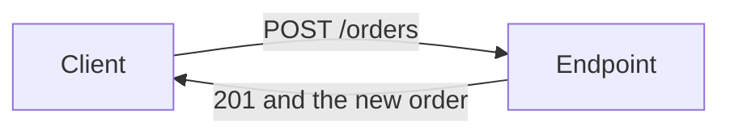

# APIs and endpoints

An API is the list of questions your server is willing to answer. An endpoint is
one question: a method plus a path. The browser, your AI tool, and any later phone
app all use this list. If the list is sloppy, every client becomes sloppy.

## How it works



The client sends a request. The request has:

- a **method**, the verb
- a **path**, the thing it is about
- **headers**, extra facts such as the content type and, sometimes, a session cookie
- a **body**, the data, for requests that send some

The server sends a response: a **status code**, headers, and a body.

**JSON** is the usual body format. It is text with labeled values:

```json
{ "title": "Milk", "quantity": 2 }
```

Say `Content-Type: application/json` when you send it. Your framework often sets
that for you.

## Methods

These are the verbs that matter. The full list is in the
[MDN methods reference](https://developer.mozilla.org/en-US/docs/Web/HTTP/Reference/Methods).

| Method | Meaning | Example |
| --- | --- | --- |
| `GET` | Read. Must not change data. | `GET /orders/42` |
| `POST` | Create, or run an action. | `POST /orders` |
| `PUT` | Replace the whole thing. | `PUT /orders/42` |
| `PATCH` | Change some fields. | `PATCH /orders/42` |
| `DELETE` | Remove. | `DELETE /orders/42` |

`GET` is safe to retry. A browser will retry it on its own. Never put "charge the
card" or "delete the account" on a `GET`.

`POST` is the right verb for "do this action" even when you are not creating a
row: `POST /orders/42/cancel`. You do not need a perfect REST noun for every
action. You need a name a person can read and a verb that will not be retried by
accident.

**Retrying.** A flaky network sends the same request twice. Creating an order
twice is bad. For payments and other "exactly once" actions, tell the AI to make
a second identical request return the original result instead of doing the work
again. That property is called idempotency. You do not have to build it for a
settings form. You do for money.

## Paths

Name the collection, then the id.

- `GET /orders` lists the signed-in user's orders
- `POST /orders` creates one
- `GET /orders/42` reads one, if this user may see it
- `PATCH /orders/42` updates it
- `DELETE /orders/42` deletes it

Plural nouns, no verbs in the path unless the path is an action (`/cancel`).
Avoid `/getOrders` and `/order`. Nest only when the relationship is real:
`/orders/42/items`.

The server decides whose orders come back. A caller who passes `userId=someone-else`
does not get those rows. The session already says who they are.

## Status codes

Use a small set. [MDN lists them all](https://developer.mozilla.org/en-US/docs/Web/HTTP/Reference/Status).

| Code | When |
| --- | --- |
| `200` | Read or update worked, and you are sending a body. |
| `201` | Created. |
| `204` | Worked, and there is no body. Common for delete. |
| `400` | The input is nonsense or missing a field. |
| `401` | Not signed in. |
| `403` | Signed in, and not allowed. |
| `404` | Nothing here you are allowed to know about. |
| `409` | The request conflicts with current data, such as a duplicate email. |
| `500` | The server failed. Do not send the stack trace to the visitor. |

`401` means "who are you?". `403` means "I know who you are, and the answer is
no". Mixing them up makes the client show the wrong screen.

For a row the caller must not see, `404` is often better than `403`. A `403` tells
them the row exists.

## Errors

Return one JSON shape for errors and stick to it:

```json
{ "error": "Title is required" }
```

The screen can show that sentence. A different shape on every route means the
frontend guesses.

## Versioning

You do not need `/v1` on day one. You need to avoid breaking a client you already
shipped. Adding a field is safe. Renaming or removing a field is not, once
something else depends on it. Write the current list of endpoints in your MCP
server notes so the next session does not invent a second name for the same
action.

## Common mistakes

- **Changing data on `GET`.** It will happen twice, and it will show up in logs
  and link previews.
- **One endpoint called `/api` that does everything.** Callers cannot cache, log,
  or secure a single blob of actions.
- **Trusting the client to filter.** The list endpoint already returns only this
  user's rows. Hiding a button is not the filter.
- **Status `200` with `{ "success": false }`.** Use a real error code so logs and
  the client can tell failure from success without reading the body.

## What to tell your AI

"REST-style paths and the methods in this table. JSON in, JSON out. `401` versus
`403` versus `404` as written here. One error shape. No writes on `GET`. Every
query is scoped to the signed-in user on the server."

## Further reading

- [MDN: HTTP methods](https://developer.mozilla.org/en-US/docs/Web/HTTP/Reference/Methods)
- [MDN: Status codes](https://developer.mozilla.org/en-US/docs/Web/HTTP/Reference/Status)
- [MDN: Headers](https://developer.mozilla.org/en-US/docs/Web/HTTP/Reference/Headers)
- Next page: [Databases](08-databases.md)
