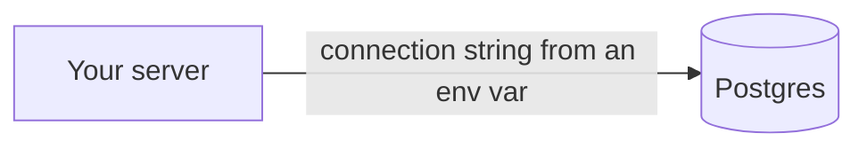

# Databases

The database is where the product's facts live: users, orders, posts, whatever
must still be there after a refresh. Your server connects to it. The browser
never does. Picking the database is mostly picking Postgres and then designing
tables that match the things your app talks about.

## How it works

A **connection string** is a URL with the address, the database name, and the
password. It lives in an environment variable such as `DATABASE_URL`. The template
is in [env-example](templates/env-example.md).

A **pool** is a small set of open connections the server reuses. Opening a new
connection on every click is slow. Your database library does the pooling. You
should know the word because hosting dashboards show the pool filling up. If it
stays full, requests wait.

**SQL** is the language of relational databases: tables, rows, and links between
them. A user has many orders. An order has many items. Those links are why you
pick a relational database for almost every product. The
[SQL glossary entry at MDN](https://developer.mozilla.org/en-US/docs/Glossary/SQL)
is a short definition. Postgres's own
[tutorial](https://www.postgresql.org/docs/current/tutorial-start.html) is the
longer one.

An **ORM** is a library that lets you create and query rows from your programming
language, and that keeps the SQL in one place. [Prisma](https://www.prisma.io/docs)
and [Drizzle](https://orm.drizzle.team/docs/overview) are common in JavaScript.
Rails, Laravel, and Django include their own. Use the ORM's query tools. Dropping
to a hand-built string of SQL with the user's text glued in is how
[injection](https://cheatsheetseries.owasp.org/cheatsheets/SQL_Injection_Prevention_Cheat_Sheet.html)
happens. Placeholders, always.

A **migration** is a saved change to the tables: "add a `canceled_at` column".
Migrations are files in git. You run them on each environment. You do not click
around in a production dashboard to add a column, because the next environment
will not have it and the next deploy will assume it does.

An **index** is a shortcut the database maintains so a lookup does not read every
row. Add one for columns you search or join on all the time, such as
`orders.user_id`. Do not index every column. Each index slows writes a little.

## Which database

| Database | What it is | Pick it when |
| --- | --- | --- |
| [Postgres](https://www.postgresql.org/docs/current/tutorial-start.html) | Relational. Tables and links. The default for real apps. | Almost every product. Hosted options include [Neon](https://www.neon.tech/docs/introduction) and [Supabase](https://supabase.com/docs). |
| [SQLite](https://www.sqlite.org/quickstart.html) | One file on disk. The same SQL, fewer moving parts. | A prototype, a single-server app, or local development. Awkward when many servers must share one file. |
| [MongoDB](https://www.mongodb.com/docs/manual/introduction/) | Documents: JSON-like records that can differ from each other. | The records genuinely do not share one shape, and you know that shape will stay loose. |

Postgres can store JSON in a column when one field is flexible. That covers a lot
of cases people open MongoDB for. Start with Postgres unless you already have a
reason not to.

**What does not belong in the database.** Uploaded files and images. Store those
in object storage (your host's file bucket) and save the address in a column.
Secrets do not belong there either, except password hashes, which are not the
password.

## A shape that survives contact with the app

Name tables after the things a person would name. `users`, `projects`,
`memberships`. Give every table an id. Give every "who owns this" table a
`user_id` or a join table, and index it.

Store money as integers of the smallest unit (cents), not as floating point.
Store times in UTC. Decide what "delete" means: a `deleted_at` timestamp lets you
undo and lets old invoices still point at a customer. A real `DELETE` is gone.

When a screen loads a list and then asks for the related row once per item, you
get one query plus one per row. A page of 50 items becomes 51 trips. Tell the AI
to load the related rows in the same query.

## Backups and access

A database you cannot restore is a prototype, whatever the UI looks like. Turn on
the host's backups before you have users. Know how to restore to a new database
once, while it is still cheap to learn.

The app connects as a user that can touch this app's tables. It does not connect
as a superuser that can drop every database on the server. The database accepts
connections from the app, not from the whole internet. Hosts call this private
networking, allowlists, or SSL required. Turn on the option they offer.

## Common mistakes

- **The database URL in frontend code or in git.** It is a password. Environment
  variable, `.env` gitignored, `.env.example` with the name and an empty value.
- **Editing production by hand.** Write a migration.
- **One table called `data`.** If you cannot name the thing, you do not know what
  you are storing yet. Stop and name the nouns.
- **Letting two requests corrupt a counter.** "Read the number, add one, write it
  back" loses updates. The database can increment in one statement. Ask for that
  when the number matters (stock, seats, balances).

## What to tell your AI

"Postgres. Connection string only from `DATABASE_URL`. Use `<Prisma or Drizzle>`
and migrations for every schema change. Index foreign keys. Scope every query to
the owner. No raw SQL built by string concatenation. No files in the database,
only their addresses."

## Further reading

- [Postgres tutorial](https://www.postgresql.org/docs/current/tutorial-start.html)
- [Postgres: creating tables](https://www.postgresql.org/docs/current/ddl.html)
- [SQLite quickstart](https://www.sqlite.org/quickstart.html)
- [MongoDB introduction](https://www.mongodb.com/docs/manual/introduction/)
- [Prisma](https://www.prisma.io/docs)
- [Drizzle](https://orm.drizzle.team/docs/overview)
- [OWASP: SQL injection prevention](https://cheatsheetseries.owasp.org/cheatsheets/SQL_Injection_Prevention_Cheat_Sheet.html)
- Next page: [Authentication](09-authentication.md)
