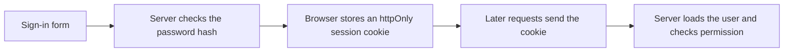

# Authentication

Authentication answers "who is this?". Authorization answers "what may they do?".
The screen can hide a button. Only the server can enforce either answer. Sign-in
is not a coat of paint you add after the feature works. The queries are wrong
until they know who is asking.

## How it works

**Passwords are hashed, one way.** The database stores the hash, never the
password. [Argon2 or bcrypt](https://cheatsheetseries.owasp.org/cheatsheets/Authentication_Cheat_Sheet.html)
are the usual algorithms. Encryption is the wrong tool here: encryption can be
reversed by whoever has the key. A hash cannot. When someone signs in, you hash
what they typed and compare. You never email them their current password. You
send a reset link instead.

**A session is a record that this browser already signed in.** The usual way to
remember it on a website you own is a cookie marked `HttpOnly` (page scripts
cannot read it), `Secure` (HTTPS only), and `SameSite` (the browser will not
attach it to random other sites' requests). The server looks the session up, loads
the user, and then runs the handler.

**A token is a signed string the client stores and sends back.** It fits a phone
app or a third party calling your API, where a browser cookie is the wrong tool.
For your own website, prefer the cookie session. A token in `localStorage` is
readable by any script on the page, which is the common AI-generated mistake.

**"Sign in with Google" is OAuth.** Google tells you this person controls that
Google account. You still create your own user row. You still decide what that
user may do. The provider does not replace your `users` table.

**Authorization is a check on the row.** "This user is an admin" is one kind.
"This user owns this project" is the kind people forget. Every read and every
write of a private row includes that condition in the query. Checking it in the
React component and not in the query is the bug where someone changes an id in
the URL and sees another customer's data.

Roles can be a column (`member`, `admin`) while you have a handful of permissions.
A full permission system is something you add when the handful stops fitting, not
on day one.

## Libraries, so you do not write crypto yourself

Writing your own password hash comparison or session id is how subtle bugs show
up. Use a library.

- [Auth.js](https://authjs.dev/getting-started) is the common choice in Next.js
  and other JavaScript apps.
- [Supabase](https://supabase.com/docs) includes auth if you are already using it
  for the database.
- Rails, Laravel, and Django each have a built-in or officially recommended auth
  path. Use that path.

Hosted auth (Clerk and others) is reasonable if you want the screens and the
session handling done for you. You still own the "may this user touch this row?"
checks in your database queries.

## What the first version needs

1. Sign up, sign in, sign out.
2. A hashed password, or a provider login, and a session cookie.
3. Every private endpoint loads the user from the session and filters by them.
4. A password reset that expires, if you accept passwords.
5. Sign-out deletes the session on the server, not only in the browser.

Email verification and two-factor can follow. Ownership checks cannot.

## Common mistakes

- **Storing the password, or logging it.** Logs are data breaches waiting for a
  viewer. Log the user id, never the password or the session token.
- **A user id in the request body.** The session is the source of identity. The
  body is input, and input can lie.
- **`404` checks only in the page.** The API must check too. Pages are not the
  only client.
- **Sessions that never expire.** Idle sessions should end. A "remember me" can
  last longer. A stolen laptop should not stay signed in forever.

## What to tell your AI

"Use `<Auth.js or the framework's auth>`. HttpOnly, Secure, SameSite session
cookie. Hash passwords with argon2 or bcrypt. Never write a password, session
token, or hash to logs. Every query for private data includes the signed-in
user's id from the session. Do not put tokens in localStorage."

## Further reading

- [OWASP Authentication Cheat Sheet](https://cheatsheetseries.owasp.org/cheatsheets/Authentication_Cheat_Sheet.html)
- [Auth.js getting started](https://authjs.dev/getting-started)
- Next page: [Security](10-security.md)
