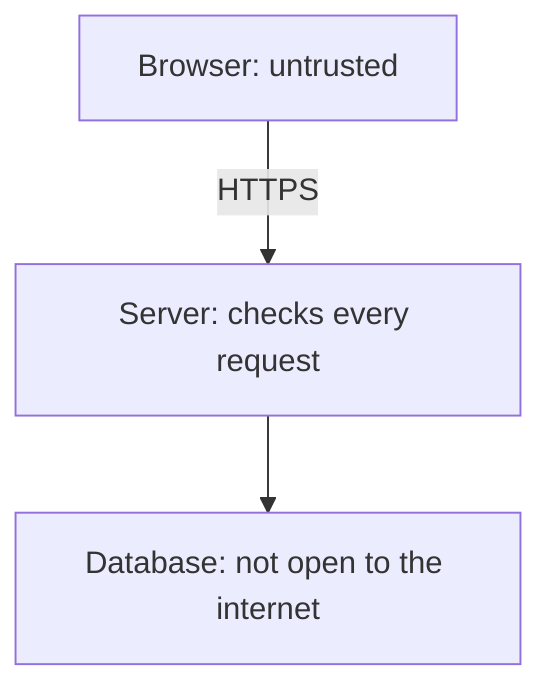

# Security

Security here means the checks that keep a stranger from reading or changing
someone else's data. You do not need to become a security engineer. You do need
to refuse a few patterns that AI tools still generate, because those patterns
compile and look fine.

## How it works

**The browser is untrusted.** Anyone can edit the JavaScript, replay a request,
or call your API with curl. Hiding a button, disabling an input, or checking a
role in React is a convenience. The server repeats every check that matters.

**HTTPS encrypts the trip** between the browser and your server. Hosts such as
Vercel, Netlify, and Render turn this on when you attach a domain. Do not ship a
login form on plain `http://`. Cookies for sessions should be `Secure`, which
means they only travel over HTTPS.

**Secrets live in environment variables**, on the server. API keys, the database
URL, and the session secret. They are not in git, not in the frontend bundle, and
not in a screenshot you paste into chat. Commit a `.env.example` that lists the
names and leaves the values empty. The real `.env` is in `.gitignore`.

## The bugs that actually happen

**SQL injection.** The database runs a query that includes text the user typed,
because someone built the query by gluing strings together. The user can change
the query. Use placeholders through your ORM or driver. The
[OWASP cheat sheet](https://cheatsheetseries.owasp.org/cheatsheets/SQL_Injection_Prevention_Cheat_Sheet.html)
shows the pattern to insist on.

**Cross-site scripting (XSS).** The page treats a user's text as HTML, so their
text can include a script. That script runs as your site, in the victim's browser.
Put user content in the page as text. Do not use `innerHTML` or a "render this
HTML" helper on raw user input. Frameworks escape text by default until someone
turns that off. The
[XSS cheat sheet](https://cheatsheetseries.owasp.org/cheatsheets/Cross_Site_Scripting_Prevention_Cheat_Sheet.html)
is the reference.

**Missing authorization.** The endpoint loads a row by id and does not check the
owner. Changing the id shows or edits someone else's data. Fix it in the query.

**CORS is not your lock.** [CORS](https://developer.mozilla.org/en-US/docs/Web/HTTP/CORS)
is a browser rule: a page on another site may call your API only if your API
says so. Scripts that are not browsers ignore it. A phone app ignores it. Allow
your website's origin. Do not allow every origin together with credentials, and
do not treat "we configured CORS" as authentication.

**Cross-site request forgery** matters when you use a cookie session. Another
site can try to submit a form to your API and the browser may attach the cookie.
`SameSite` cookies and a CSRF token on cookie-authenticated mutations are the
usual defense. Your auth library should be doing this. If you switch to a token
you invented, you have to do it yourself, which is a reason not to invent it.

**Dependencies.** The packages you install can be the bug. Let the host or GitHub
open update warnings, and do not install a package you cannot tie to a real need.

**Errors and logs.** Visitors see a plain "something went wrong". They do not see
a stack trace, a SQL statement, or an env var. Logs may include a request id and
a user id. They must not include passwords, session tokens, or card numbers.

**Rate limits.** Sign-in, password reset, and anything expensive get a limit per
IP and per account. This will not stop a determined attacker. It will stop the
accident and the cheapest abuse.

The [OWASP Top 10](https://owasp.org/www-project-top-ten/) is the industry list
these issues come from. Read the titles. You do not have to memorize it to ship
the first version if the checks above are in the code.

## Common mistakes

- **A secret in `NEXT_PUBLIC_` or any other "expose to the browser" variable.**
  Those prefixes mean the value ships to every visitor. Only truly public values
  go there, such as a publishable site URL.
- **Disabling TLS checks or auth "until it works".** It will stay disabled.
- **Admin routes protected by hiding the link.** The route checks the role.
- **Pasting a production key into the AI chat** so it can "just test". Use a
  local development key. Rotate any key that has been in a chat or a commit.

## What to tell your AI

"HTTPS only. Secrets in server environment variables. Parameterized queries.
Framework escaping left on. Owner check on every private query. Cookie session
with HttpOnly, Secure, and SameSite. CORS allows only our site. No stack traces
to the client. Rate-limit sign-in. Do not add a package that is not required for
this task."

## Further reading

- [MDN: Web security](https://developer.mozilla.org/en-US/docs/Web/Security)
- [MDN: CORS](https://developer.mozilla.org/en-US/docs/Web/HTTP/CORS)
- [OWASP Top 10](https://owasp.org/www-project-top-ten/)
- [OWASP Authentication Cheat Sheet](https://cheatsheetseries.owasp.org/cheatsheets/Authentication_Cheat_Sheet.html)
- [OWASP SQL injection prevention](https://cheatsheetseries.owasp.org/cheatsheets/SQL_Injection_Prevention_Cheat_Sheet.html)
- [OWASP XSS prevention](https://cheatsheetseries.owasp.org/cheatsheets/Cross_Site_Scripting_Prevention_Cheat_Sheet.html)
- Next page: [From your laptop to production](11-from-laptop-to-production.md)
