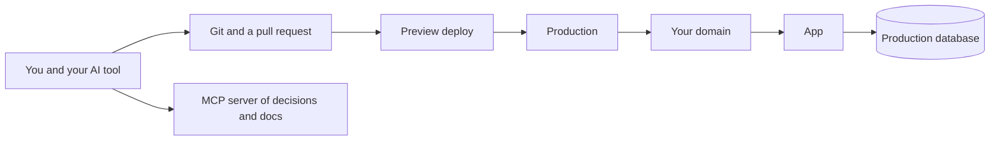

# From your laptop to production

Production is the copy of your app that real people use. Getting there is not a
final upload. It is the same pieces you already have, with real secrets, a real
database, a domain, and a way to undo a bad release. The git and pull-request half
of this is [How shipping works](../docs/05-how-shipping-works.md). This page is how
the architecture stays intact once it is online.

## How it works

**Three environments, three sets of settings.**

| Environment | Who uses it | Database | Secrets |
| --- | --- | --- | --- |
| Local | You, on your computer | A dev database, or a local one | Dev keys only |
| Preview | You, on a private URL per change | A separate database, never production | Preview keys |
| Production | Customers | The real database, with backups | Production keys, only on the host |

Same code. Different environment variables. If preview points at the production
database, a test signup is a real signup and a test delete is a real delete.

**The host runs the server.** For a Next.js, Nuxt, SvelteKit, or Astro app,
[Vercel](https://vercel.com/docs) and [Netlify](https://docs.netlify.com/) are the
usual hosts. For a long-running Express, Fastify, Rails, Laravel, or Django
process, a service such as [Render](https://render.com/docs) fits better, because
those apps expect a process that stays up. The host builds your project, starts
it, terminates HTTPS, and injects environment variables. You do not SSH in to edit
code on the server. The next deploy would erase that edit, and nobody could review
it.

**The domain** is the name people type. You attach it at the host and set the DNS
records they show you. HTTPS certificates come with that on the hosts above.

**Migrations run as part of going live**, before the new code serves traffic.
The new code should tolerate the previous schema for the few minutes a deploy
takes, or you deploy the migration first. "It worked on my machine" is often "my
machine has a column production does not".

**Logs and errors.** The host keeps logs. Add an error reporter if you want a
ping when a request throws. Either way: no passwords or tokens in the message, and
a plain error page for the visitor.

**Rollback.** Know the host's "redeploy the previous version" button before you
need it. Database migrations that delete columns are harder to undo than code.
Prefer adding columns and writing both for a release, then removing the old one
later.

**Backups.** Turn them on for production Postgres the day you create it. A restore
drill once is worth more than a backup setting you have never tried.

## A release, in order

1. The change is on a branch, with a pull request.
2. Automated checks run. Tests for sign-in, for "this user cannot read that user's
   row", and for any payment path are the ones that earn their keep first.
3. You click through the preview: sign up, the main task, sign out, and one action
   you are not allowed to do.
4. You merge. The host deploys. Migrations run.
5. You watch logs for a few minutes and try the live site once yourself.

That is the whole architecture under load: browser, server, database, plus the
discipline of which copy you are talking to.

## Common mistakes

- **One database shared by local, preview, and production.** You will wipe a
  customer while testing.
- **Editing production env vars and forgetting preview.** The next bug "only
  happens in prod" because prod has a setting the code never saw in preview.
- **Manual steps in a notebook.** If the deploy needs a command, put it in the
  host's build or release command so the next person, including future you, runs
  it.
- **No rollback plan.** Find the button while the site is healthy.

## What to tell your AI

"Three environments. `DATABASE_URL` and secrets differ per environment and are
never committed. Preview must not use the production database. Migrations run on
release. Give me the host's steps for deploy and rollback, and a test that a user
cannot read another user's row."

## Further reading

- [How shipping works](../docs/05-how-shipping-works.md)
- [Vercel docs](https://vercel.com/docs)
- [Netlify docs](https://docs.netlify.com/)
- [Render docs](https://render.com/docs)
- [Production checklist](checklists/production.md)
- Next page: [Persistent context with an MCP server](12-persistent-context-with-mcp.md)
