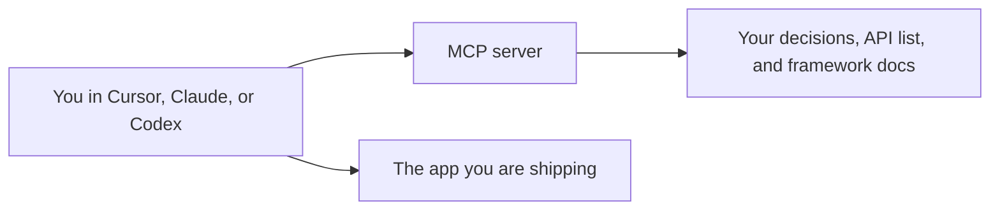

# Persistent context with an MCP server

An AI coding tool forgets. A new chat does not know that you chose Next.js, that
orders belong to the signed-in user, or that the error JSON is `{ "error": "..." }`.
It will invent a second pattern. An MCP server is how you stop that. It is a
searchable memory your tools can query on every session. Set it up before the app
gets big, and leave it connected while you build.

MCP means Model Context Protocol. It is a standard way for an AI app to use
outside information and tools. The server holds the information. Cursor, Claude,
Codex, and other tools are the clients.

## How it works

Without this, you re-explain the product in every chat, and the tool still drifts.
With it, you tell the tool to look the decision up before it writes. The same
server can be connected to more than one tool, so you are not copying notes between
them.

This is the same idea as the rest of this repository.
[Why your AI keeps forgetting](../docs/02-why-context-matters.md) explains the
failure. [The starter architecture](../docs/03-starter-architecture.md) is a
no-code way to stand up the server. The
[connect-mcp-server skill](../skills/connect-mcp-server/SKILL.md) is the checklist
for wiring it into the tool you use.

## What to put in it while you build

Index sources that answer "what did we decide?" and "how does this framework
actually work today?":

- This `fullstack/` guide, so the tool reads the same rules you read
- The current docs for the framework, database library, and auth library you chose
- A short decisions note you maintain: stack, folder layout, endpoint list, error
  shape, and "we do not do X"
- Your product notes: who the user is, what they can save, what is private

Leave secrets out. An MCP server is context for the model. API keys, database
URLs, and session secrets do not belong in a document the model retrieves. Those
stay in environment variables.

When a decision changes, change the note. A stale "we use Mongo" page is worse
than no page, because the tool will follow it with confidence.

## If the product itself answers questions

Some apps you ship are AI products: they answer from your docs, your help center,
or your files. Those apps need persistent context too, for the *user's* question,
not only for you while you code. That version is
[what RAG is](../docs/01-what-is-rag.md). One server can serve both jobs only if
you mean it to. Your private build notes and your public help center are different
sources. Do not index private decisions into a server your customers can query.

## Ways to get a server

- A hosted builder that turns links and files into an endpoint. One is
  [MCP Studio](https://appatools.com/mcp-studio?utm_source=github&utm_medium=oss&utm_campaign=ship-with-ai&utm_content=fullstack-mcp)
  (disclosure: maintained by the author of this repo). It has a free tier.
- An MCP server your docs vendor already publishes for their docs.
- An open-source MCP server you run yourself, if you are comfortable operating one.

Any of these works if the tool can call it and the sources are the ones above.
Nothing else in this track requires a specific vendor.

## When to connect it

Connect it before the first large generation, then again whenever you add a
source. A server you connect after the app is a tangle still helps, and it helps
more if you write the decisions note from what the code actually does today.

Confirm the connection the way the skill says: list the tools, ask a question your
notes answer, and check that the reply cites the note. A server that is "added"
and never queried is a logo in a settings panel.

## Common mistakes

- **Pasting the whole architecture into each chat instead.** The paste is gone
  next session, and it crowds out the code.
- **Indexing secrets or production data.** Context is for rules and docs.
- **Two servers that disagree.** One server for build decisions. Update it. Do not
  keep a second copy in a random doc the tool also reads.
- **Skipping it because the first afternoon went well.** Drift shows up on day
  three, when a new chat adds a second auth approach.

## What to tell your AI

"Before you write code, search the MCP server for the stack, the endpoint list,
and the security rules. If a search disagrees with a file, stop and tell me. Do
not invent a library, a route shape, or a storage choice that the notes do not
already allow."

## Further reading

- [Why context matters](../docs/02-why-context-matters.md)
- [Starter architecture](../docs/03-starter-architecture.md)
- [Connect an MCP server](../skills/connect-mcp-server/SKILL.md)
- [MCP introduction](https://modelcontextprotocol.io/docs/getting-started/intro)
- Next page: [Choose your stack](13-choose-your-stack.md)
