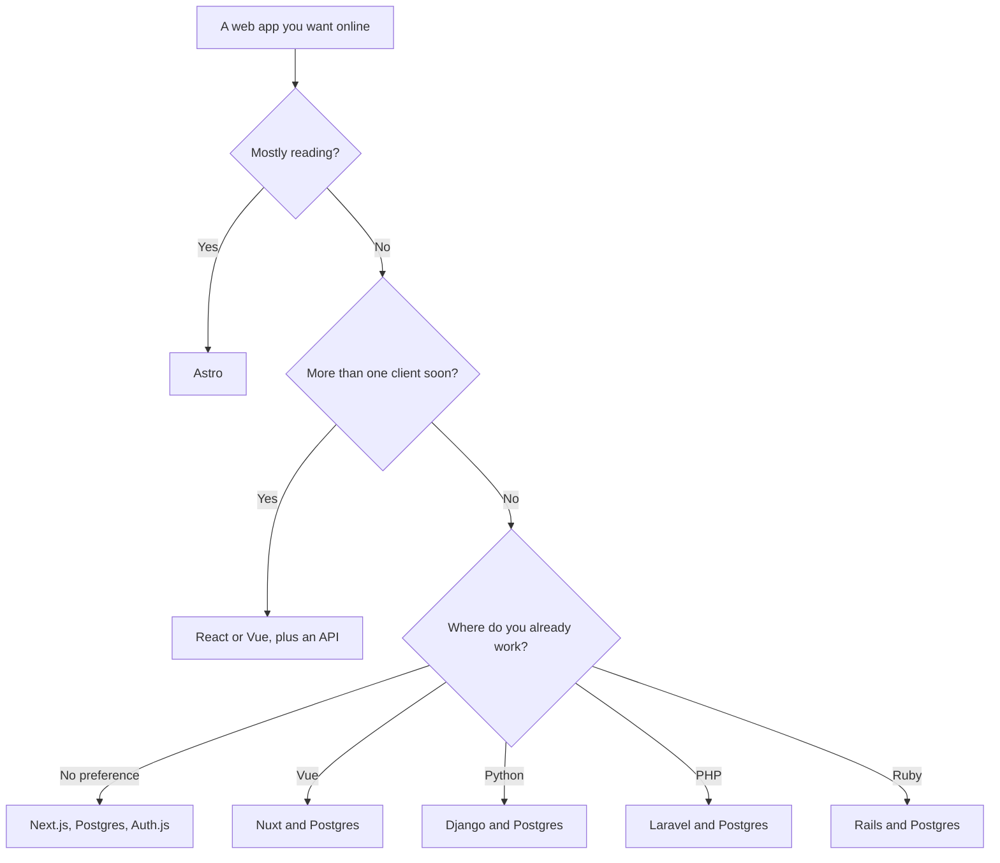

# Choose your stack

Pick the smallest stack that matches the app, write it down, and hand that
paragraph to your AI. Changing frameworks after the screens exist is a rewrite.
Reading two more blog posts is cheaper.

Web only. If the product is a phone app first, stop. This track will not choose
that stack well.

## How it works



## Defaults that are boring on purpose

**A logged-in product, one website, JavaScript.** Next.js (App Router), React,
Postgres, Prisma or Drizzle, Auth.js, Tailwind, hosted on Vercel, database on Neon
or Supabase. AI tools have seen this combination more than any other, so less of
the code is invented. The perks of the other frameworks are real. They win when
the row below says they do.

**You want HTML-like templates.** Nuxt, Vue, Postgres. Same shape, different
screen language.

**The site is content.** Astro. Add an island of React or Vue only where a widget
needs it.

**The site is forms and pages and you want less JavaScript.** HTMX, with Rails,
Django, Laravel, or a small server rendering HTML.

**You already live in Python, PHP, or Ruby.** Django, Laravel, or Rails. Fighting
your language to chase a JavaScript default wastes the week. Hold the AI to that
framework's current guides with an MCP server.

**A second client is real, not hypothetical.** Keep the rules in an API (Next.js
route handlers, or Express, Fastify, or Hono if the API is its own deploy). The
website is one client. A later phone app is another. Do not split on day one
because a slide said "mobile later". Do split when someone is actually building
the second client, or when a partner must call you this month.

**A large team wants one enforced structure.** Angular on the frontend, or NestJS
for a large API, or Rails or Laravel, which are opinionated all the way down.
Structure is their perk. Ceremony is the cost.

**Svelte.** SvelteKit and Postgres, when you want small components and you will
attach the SvelteKit docs so the AI stops guessing React patterns.

**Solid or Qwik.** Only when their specific perk (fine-grained updates, or
resuming without a big download) is the problem you have. Not as a default.

## Write this down

Copy this into the decisions note you index in the MCP server. Fill the blanks.
Delete the lines you do not mean.

```text
App:
Who uses it:
Main task:
Stack: <framework>, <database>, <auth>, <styling>
API lives: <inside the app | separate Express/Fastify/Hono/Nest>
Host:
Private data rule: every query is scoped to the signed-in user
Error shape: { "error": "<sentence>" }
We are not using: <the frameworks you considered and rejected>
```

"We are not using" is the line that prevents the next chat from adding Vue to a
Next.js app because a component on the internet was written in Vue.

## What "95 percent vibe coded" still requires from you

The AI can write the components, the routes, the migrations, and the host config.
You still:

1. Choose the row above and refuse extra services.
2. Keep secrets out of the browser and out of git.
3. Click through sign-up, the main task, and one forbidden action on a preview.
4. Leave the MCP server connected so session ten matches session one.

The [production checklist](checklists/production.md) is that list with the rest of
the checks. The [prompts](prompts/README.md) assume you have filled in the note.

## Common mistakes

- **Choosing five tools from five posts.** One framework, one database, one auth
  library, one styling system.
- **Optimizing for a million users.** The first host and Postgres are enough. You
  will know when they are not, because the site will be slow or expensive. That
  is a later decision, with evidence.
- **Letting the AI pick a new library mid-feature.** If it was not in the note,
  the answer is no until you update the note on purpose.

## Further reading

- [Frontend frameworks](04-frontend-frameworks.md)
- [Full-stack frameworks](05-fullstack-frameworks.md)
- [Backends](06-backends-and-express.md)
- [Decisions to make before you prompt](checklists/before-you-prompt.md)
- [Prompts to paste](prompts/README.md)
- [Stack prompts, with the reason in each one](../prompts/README.md)
